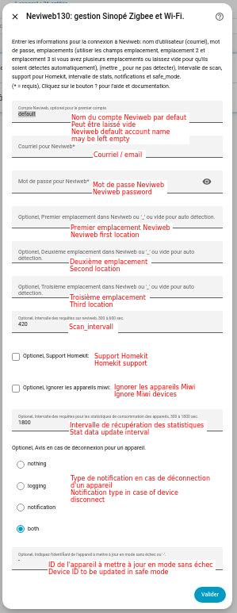
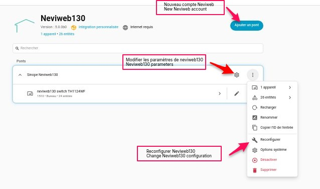
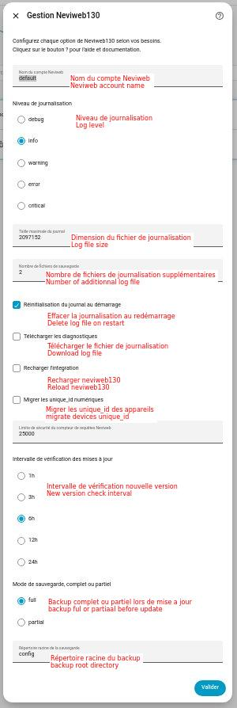
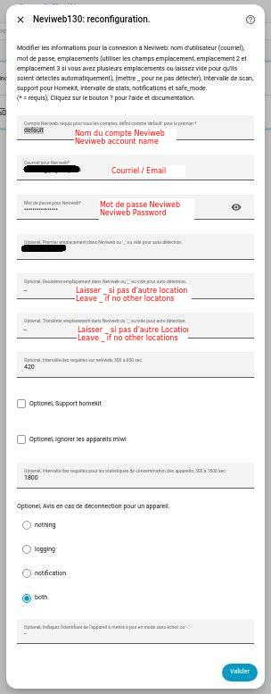
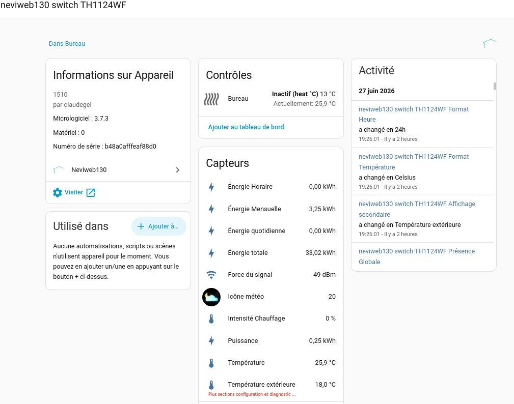
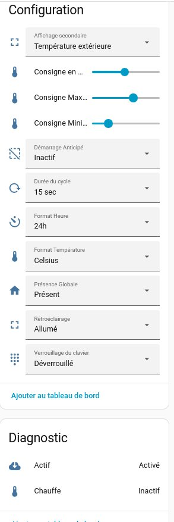
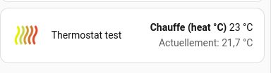
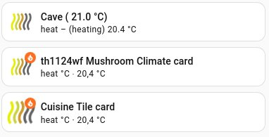

## Home Assistant Neviweb130 Custom Components
[🇫🇷 Version française](doc/readme_fr.md)

Custom integration to use [Neviweb](https://neviweb.com/) devices in [Home Assistant](http://www.home-assistant.io) (HA). Neviweb is the Sinopé Technologies platform for their smart devices: thermostats, light switches and dimmers, load controllers, plugs, valves, water leak detectors and more.

Neviweb130 (Sinope Neviweb130 in HACS) manages the Zigbee devices connected to Neviweb through the GT130 gateway, and the Wi-Fi devices connected directly to Neviweb. New Sinopé devices are added as they are launched. If your device is not supported yet, [open an issue](https://github.com/claudegel/sinope-130/issues/new/choose) and it will be added quickly.

> 💛 **Enjoying this integration?** You can support its development:
> [](https://www.paypal.me/phytoressources/) or
> [](doc/Donations.md)

## Table of contents

- **Getting started**
  - [Before you start](#before-you-start)
  - [Installation](#installation)
  - [Adding a Neviweb account](#adding-a-neviweb-account)
  - [Account parameters](#account-parameters)
  - [Integration options](#integration-options)
  - [Upgrading from version 4.x](#upgrading-from-version-4x)
- **Using Neviweb130**
  - [Devices and entities](#devices-and-entities)
  - [Energy and water statistics](#energy-and-water-statistics)
  - [Éco Sinopé peak periods](#éco-sinopé-peak-periods)
  - [Actions (services)](#actions-services)
  - [Sedna valve](#sedna-valve)
  - [Daily request counter](#daily-request-counter)
  - [Updates](#updates)
  - [Language](#language)
- **Dashboards**
  - [Device and weather icons](#device-and-weather-icons)
  - [Card examples](#card-examples)
- **Help**
  - [Troubleshooting](#troubleshooting)
  - [Device hard reset](#device-hard-reset)
  - [Supported devices](#supported-devices)

# Getting started

## Before you start

- Your devices must already be added to your Neviweb portal: Zigbee devices through a GT130 gateway, Wi-Fi devices directly, and some Zigbee devices through a Sedna valve. See your device manual or [Neviweb support](https://support.sinopetech.com/).
- Check that your devices are in the [supported devices](#supported-devices) list.
- MiWi devices (GT125) are not supported by this integration. Use one of the other Sinopé integrations below, they can all run at the same time.

<details>
<summary>Other Sinopé integrations</summary>

- [**neviweb**](https://github.com/claudegel/sinope-1) (HACS: Sinope Neviweb), for MiWi devices through the Neviweb portal.
- [**sinope**](https://github.com/claudegel/sinope-gt125) (HACS: Sinope GT125), for devices managed directly through your GT125 gateway.
- [**neviweb130**](https://github.com/claudegel/sinope-130) (HACS: Sinope Neviweb130), this integration, for Zigbee and Wi-Fi devices through the Neviweb portal.
- [**sinope-zha**](https://github.com/claudegel/sinope-zha), new Sinopé quirks for ZHA before they are merged into zha-device-handlers. With a Zigbee coordinator such as the ConBee II USB dongle, ZHA manages your Zigbee devices locally. Copy the sinope-zha files into your HA setup to test new quirks: ZHA loads them in place of the standard Sinopé quirks.

Zigbee devices managed directly through ZHA must be removed from Neviweb, as a device cannot be on two Zigbee networks at the same time.

</details>

## Installation

**With HACS (recommended):** search for **Sinope Neviweb130** in HACS, install it and restart Home Assistant.

<details>
<summary>Manual installation</summary>

1. Download the zip file of this repository with the green Code button.
2. Extract it and copy the `custom_components/neviweb130` folder into the `custom_components` folder of your Home Assistant `config` directory (where `configuration.yaml` is).
3. Restart Home Assistant.

Your config directory should look like this:

```
config/
  configuration.yaml
  custom_components/
    neviweb130/
      __init__.py
      binary_sensor.py
      button.py
      climate.py
      config_flow.py
      const.py
      coordinator.py
      devices.py
      exceptions.py
      helpers.py
      light.py
      manifest.json
      number.py
      schema.py
      select.py
      sensor.py
      services.yaml
      session_manager.py
      strings.json
      switch.py
      update.py
      valve.py
      translations/en.json
      translations/fr.json
```

</details>

To show device and weather pictures in your dashboards, also copy the icons (see [Device and weather icons](#device-and-weather-icons)).

## Adding a Neviweb account

1. Go to Settings → Devices & services.
2. Click **Add integration** and search for **Sinope Neviweb130**.
3. Enter your Neviweb email and password. The other fields can usually stay as they are (see [Account parameters](#account-parameters)).



Neviweb130 then loads and retrieves your Neviweb devices.

**More than one Neviweb account:** add the integration again for each account, with a different **prefix**. Each Neviweb account can be added only once.

## Account parameters

These are asked when you add an account. To change them later, use **Reconfigure** on the integration page.

| Parameter         | Default            | Description |
|-------------------|--------------------|-------------|
| **prefix**        | default            | Name of the account. Change it only if you add more than one Neviweb account. Each account needs a different prefix, without spaces or accented characters. |
| **username**      |                    | The email address you use to log into Neviweb. Required. |
| **password**      |                    | Your Neviweb password. Required. |
| **network**       | 1st location found | Name of the Neviweb location to control. Leave empty for auto detection. |
| **network2**      | 2nd location found | Second location to control. Leave empty if you have only one. |
| **network3**      | 3rd location found | Third location to control. A third location must be activated by Sinopé. |
| **scan_interval** | 420                | Seconds between each device update, from 300 to 600. Sinopé asks for at least 5 minutes between polls. |
| **stat_interval** | 1800               | Seconds between each energy statistics update, from 300 to 1800. |
| **homekit_mode**  | False              | Adds HomeKit specific values. Not needed if you don't use HomeKit. |
| **ignore_miwi**   | False              | Set to True if a selected location also contains MiWi (GT125) devices, to avoid the unsupported device warning. |
| **notify**        | both               | How device errors are reported: `nothing`, `logging`, `notification` or `both`. |
| **safe_mode**     | -                  | Comma separated list of device IDs to poll in safe mode, or `-` for none. In safe mode, attributes not supported by the device firmware are skipped. A device that returns `DVCATTRNSPTD` is added automatically and you get a notification. |

<details>
<summary>About locations (network, network2, network3)</summary>

Location names are shown at the top of the first page after logging into Neviweb. If you have more than one location, click on the icon at the top to see all of them.


- Zigbee (GT130) and Wi-Fi devices can be in the same location or in separate ones. Neviweb130 manages up to three locations per account.
- If you also have a GT125 connected to Neviweb, enter your location names, otherwise the GT125 location could be picked up by mistake.
- Set an unused location to `_` so Neviweb130 does not search for it.
- Write names exactly as in Neviweb, including capitalization. Accented letters are refused.

</details>

## Integration options

Everything is under Settings → Devices & services → Neviweb130. Click **Configure** to change these options. Changes apply without restarting Home Assistant.



| Option | Default | Description |
|--------|---------|-------------|
| **log_level** | info | Level of messages written to the log file. Set to `debug` to investigate a problem. |
| **log_max_bytes**, **log_backup_count**, **log_reset_on_start** | 2 MB, 2, on | Size, rotation and reset at startup of the log file (see [Troubleshooting](#troubleshooting)). |
| **download_log** | | Copies the log file to `/local/neviweb130.log` so you can download it from your browser. The copy is deleted after 30 minutes. |
| **reload** | | Reloads Neviweb130 without restarting Home Assistant. |
| **migrate** | | Runs the unique_id migration again. It already runs automatically at startup. |
| **request_limit** | 25000 | Daily safety limit of requests sent to Neviweb (Neviweb's own limit is 30000). |
| **update_check_interval** | 6h | How often the update entity checks GitHub for a new version: 1h, 3h, 6h, 12h or 24h. |
| **backup_mode**, **backup_folders** | full, config | Backup made before installing an update. `full` calls `hassio.backup_full`, `partial` calls `hassio.backup_partial` with the listed folders. Needs a Home Assistant installation with the Supervisor. |

See also [doc/options_en.md](doc/options_en.md).

<details>
<summary>Screenshots of the options and reconfiguration windows</summary>





</details>

## Upgrading from version 4.x

Nothing to do at first: on the first startup of version 5, Neviweb130 imports the `neviweb130:` block of `configuration.yaml` into the UI, one entry per account (the `accounts:` format is supported). It also converts `unique_id`s and device model numbers to text, as required by Home Assistant. Entity names are kept.

After this first startup:
- remove or comment out the `neviweb130:` block in `configuration.yaml`,
- check your automations, scripts and dashboards. They keep working, but the new [attribute entities](#devices-and-entities) can replace your template sensors,
- remove your Custom-UI customizations for Neviweb130, the integration now sets the device pictures itself.

If you were running a copy of the integration under another name (e.g. `neviweb131`) to manage a second account, add that account to Neviweb130 instead (see [Adding a Neviweb account](#adding-a-neviweb-account)).

<details>
<summary>Legacy configuration.yaml reference (version 4.x)</summary>

Single account:

```yaml
neviweb130:
  username: '«your Neviweb username»'
  password: '«your Neviweb password»'
  network: '«your gt130 location name in Neviweb»'
  network2: '«your second location name in Neviweb»'
  network3: '«your third location name in Neviweb»'
  scan_interval: 360
  homekit_mode: False
  ignore_miwi: False
  stat_interval: 1800
  notify: "both"
  safe_mode: "-"
```

Multiple accounts (since 3.1.0). `location` and `network` are aliases, and global settings apply to all accounts:

```yaml
neviweb130:
  accounts:
    - username: 'your_email@example.com'
      password: 'your_password'
    - username: 'parents_email@example.com'
      password: 'parents_password'
      location: 'Chalet'
      prefix: 'parents'
  scan_interval: 360
  homekit_mode: False
  ignore_miwi: False
  stat_interval: 1800
  notify: "both"
  safe_mode: "-"
```

</details>

# Using Neviweb130

## Devices and entities

Each device has its own page under Settings → Devices & services → Neviweb130. Besides the main entity (climate, light, switch, valve or sensor), Neviweb130 creates an entity for most device attributes:
- **sensor**, for numeric values such as temperature, voltage and energy statistics,
- **binary_sensor**, for on/off states such as leak sensors and the GT130 `gateway_status` (online or offline in Neviweb),
- **button**, to reset an on/off or alarm attribute,
- **number**, to change a numeric value (minimum/maximum temperature, away temperature, etc.),
- **switch**, to enable or disable an attribute,
- **select**, for attributes with a list of choices.

These entities can be used directly in automations and in the Energy dashboard, so template sensors on attributes are no longer needed. If an attribute entity is missing, open an issue.

<details>
<summary>Sample device page</summary>




</details>

## Energy and water statistics

Devices that report energy in Neviweb get these sensors, in kWh, ready for the HA Energy dashboard:
- **Total Energy** (`total_kwh_count`, total_increasing),
- **Monthly**, **Daily** and **Hourly** energy (`monthly_kwh_count`, `daily_kwh_count`, `hourly_kwh_count`, total).

2nd gen Sedna valves with a flow sensor get the same set for water, in liters: **Total Flow** (`total_flow_count`) and the monthly, daily and hourly flow counts.

Statistics are polled from Neviweb every `stat_interval` seconds (default 1800). The `hourly_kwh`, `daily_kwh` and `monthly_kwh` attributes are still exposed on climate, light and switch entities, and `hourly_flow`, `daily_flow` and `monthly_flow` on valve entities.

## Éco Sinopé peak periods

If at least one thermostat or load controller is registered in the Éco Sinopé program, you can detect when Neviweb announces a peak period. Follow the **eco_status** attribute: it changes from «off» to «on» at the beginning of the pre-heating period. Build an automation on this change to prepare your other HA devices.

<details>
<summary>All Éco Sinopé attributes</summary>

- Thermostats:
  - **eco_status**: «off» during normal operation, turns «on» at the beginning of the pre-heating period.
  - **eco_setpoint**: turns «on» during the peak period if the device is managed by Éco Sinopé.
  - **eco_optout**: turns «on» if somebody changes the setpoint during the peak period.
  - **eco_power_relative**: minimum temperature, relative to the setpoint, at which the thermostat turns on automatically for frost protection.
  - **eco_power_absolute**: limits the pi_heating_demand level between 1 and 100% during the peak period.
  - **eco_setpoint_status**: turns «on» if the device setpoint is changed by Éco Sinopé.
  - **eco_setpoint_delta**: 0 during normal operation, between -10 and +10 during the peak period. Positive for pre-heating, negative for the peak period. It is added to the regular setpoint: -10 = setpoint reduced by 10°C.
- Load controllers:
  - **eco_status**: same as thermostats.
  - **eco_onoff**: turns «on» during the peak period if the device is managed by Éco Sinopé. The device is turned off during the peak period. Nothing is done during the pre-heating period.
  - **eco_optout**: turns «on» if somebody turns the device on during the peak period.
- MC3100ZB multi-controller:
  - **eco_status**: same as thermostats.
  - **eco_setpoint**: no change during the peak period.
  - **eco_optout**: turns «on» if somebody changes the on/off value during the peak period.
  - **eco_power_relative**: minimum temperature, relative to the room temperature, at which the MC3100ZB turns on automatically for frost protection.
  - **eco_power_absolute**: usage unknown.

</details>

## Actions (services)

Neviweb130 adds actions (services) to change device settings that the standard HA actions don't cover: keypad lock, timers, display, setpoint limits, alerts, Éco Sinopé options, heat pump and valve settings, and more. Find them in Developer tools → Actions by typing `neviweb130.`, or in the action list of the automation editor. Each action has a description and its fields in the UI.

Actions marked «Equipment configuration should be performed by a professional» change how the HVAC equipment runs. Use them only if you know your installation.

<details>
<summary>Full list of actions</summary>

- neviweb130.set_second_display, to change the thermostat second display from setpoint temperature to outdoor temperature. This needs to be sent only once to each device.
- neviweb130.set_climate_keypad_lock, to lock the keypad of the climate device.
- neviweb130.set_light_keypad_lock, to lock the keypad of the light device.
- neviweb130.set_switch_keypad_lock, to lock the keypad of the switch device.
- neviweb130.set_light_timer, to set a timer in seconds (0 to 10800) after which the light turns off.
- neviweb130.set_switch_timer, to set a timer in seconds (0 to 10800) after which the switch or multi-controller turns off.
- neviweb130.set_switch_timer2, to set timer 2 in seconds (0 to 10800) after which the multi-controller turns off.
- neviweb130.set_led_indicator, to change the LED indicator color and intensity of light devices for the «on» and «off» states. Any RGB color can be sent with the red, green and blue parameters.
- neviweb130.set_time_format to display time in 12h or 24h on thermostats.
- neviweb130.set_temperature_format to display temperature in Celsius or Fahrenheit format on thermostats.
- neviweb130.set_backlight to set backlight intensity in state «on» or «off» for thermostats.
- neviweb130.set_wattage to set wattageOverload for light devices.
- neviweb130.set_auxiliary_load to set the status and load of the auxiliary heating.
- neviweb130.set_setpoint_min to set minimum setpoint temperature for thermostats.
- neviweb130.set_setpoint_max to set maximum setpoint temperature for thermostats.
- neviweb130.set_cool_setpoint_min to set minimum cooling setpoint for TH1134ZB-HC.
- neviweb130.set_cool_setpoint_max to set maximum cooling setpoint for TH1134ZB-HC.
- neviweb130.set_floor_limit_low to set minimum setpoint temperature for floor thermostats. (5 to 34°C, 0 = off)
- neviweb130.set_floor_limit_high to set maximum setpoint temperature for floor thermostats. (7 to 36°C, 0 = off)
- neviweb130.set_sensor_leak_alert to set the leak alert of the water leak sensor.
- neviweb130.set_sensor_temp_alert to set the low temperature alert of the water leak sensor.
- neviweb130.set_sensor_closure_action to set the valve closure action on leak, only for leak sensors connected directly to the Sedna valve.
- neviweb130.set_valve_alert to set low battery alert status.
- neviweb130.set_valve_temp_alert to set the low temperature alert on the Sedna valve.
- neviweb130.set_early_start to set early heating on/off for Wi-Fi thermostats.
- neviweb130.set_air_floor_mode to switch between floor or ambient temperature sensor to control room temperature.
- neviweb130.set_floor_air_limit to set floor thermostat max air limit temperature.
- neviweb130.set_phase_control to set phase control mode for DM2550ZB dimmer (reverse or forward).
- neviweb130.set_hvac_dr_options to set or reset DR period option in Neviweb for thermostats.
- neviweb130.set_hvac_dr_setpoint to adjust the thermostat setpoint reduction during the DR period, 100 to -100 (°C × 10). 0 only makes the small icon flash.
- neviweb130.set_load_dr_options to set or reset DR period options in Neviweb for load controller.
- neviweb130.set_cycle_output to set main cycle length of low voltage thermostat in minutes.
- neviweb130.set_aux_cycle_output to set auxiliary cycle length of low voltage thermostats in minutes.
- neviweb130.set_control_onoff to change the status of outputs 1 and 2 of the Sedna valve multi-controller.
- neviweb130.set_battery_type to set the battery type, alkaline or lithium, for the water leak sensor.
- neviweb130.set_tank_size to set the water heater tank capacity for Calypso RM3500ZB.
- neviweb130.set_low_temp_protection to activate or not the water heater protection for water temperature. Below 45°C, heating restarts automatically.
- neviweb130.set_controlled_device to change the name of the device controlled by the RM3250ZB load controller.
- neviweb130.set_flow_meter_model to change the flow meter model connected to the 2nd gen Sedna valve and start/stop leak protection from flow meter.
- neviweb130.set_flow_meter_delay to set the leak delay before the valve closes when a leak is detected by the flow meter.
- neviweb130.set_flow_meter_options to set the flow meter action: close the valve (yes/no) and to send alert message (yes/no), or just do nothing.
- neviweb130.set_tank_type to set tank type for LM4110-ZB, propane or oil.
- neviweb130.set_gauge_type to set gauge type for LM4110-ZB on propane tank, model 5-95 or 10-80.
- neviweb130.set_low_fuel_alert to set low fuel level limit for propane tank, 0 (off), 10, 20 or 30%.
- neviweb130.set_tank_height to set the oil tank height for LM4110-ZB sensor, 0 (off), 23, 24, 35, 38, 47, 48, 50.
- neviweb130.set_fuel_alert to set the fuel alert on/off for LM4110-ZB.
- neviweb130.set_power_supply to set the Sedna valve power source: battery, acups-01 or both.
- neviweb130.set_battery_alert to set battery alert on/off for LM4110-ZB.
- neviweb130.set_input_output_names to set name for input 1 and 2 and output 1 and 2 of MC3100ZB device.
- neviweb130.set_activation to activate or block Neviweb polling for a device.
- neviweb130.set_sensor_type to set the sensor type, 10k or 12k.
- neviweb130.set_remaining_time to set value for coldLoadPickupRemainingTime attribute.
- neviweb130.set_on_off_input_delay to set the «on» or «off» delay in seconds for input 1 and 2 of MC3100ZB.
- neviweb130.set_em_heat to turn auxiliary heat on or off for floor and low voltage thermostats. It replaces turn_aux_heat_on and turn_aux_heat_off, deprecated by HA.
- neviweb130.set_display_config to turn the heat pump display on or off.
- neviweb130.set_sound_config to turn the heat pump sound on or off.
- neviweb130.set_heat_pump_operation_limit to set the minimum operating temperature of the heat pump.
- neviweb130.set_heat_lockout_temperature to set maximum outside temperature limit to allow heating device operation.
- neviweb130.set_cool_lockout_temperature to set minimum outside temperature limit to allow cooling device operation.
- neviweb130.set_hc_second_display to set second display of TH1134ZB-HC thermostat.
- neviweb130.set_language to set display language on TH1134ZB-HC thermostats.
- neviweb130.set_neviweb_status, to set global Neviweb status, home / away, via the GT130 sensor.
- neviweb130.set_climate_neviweb_status, to set global Neviweb status, home / away, via any thermostat.
- neviweb130.set_refuel_alert, to get an alert when the propane tank is refueled.
- neviweb130.set_accessory_type, to set the accessory type (humidifier, dehumidifier, air exchanger) connected to TH6500WF or TH6250WF.
- neviweb130.set_schedule_mode, to set the schedule mode, manual or auto for TH6500WF or TH6250WF.
- neviweb130.set_flow_alarm_disable_timer, to disable the abnormal flow alarm for 1 second to 24 hours.
- neviweb130.set_heatcool_setpoint_delta, to set a temperature delta between heating setpoint and cooling setpoint from 1 to 5°C in auto mode for TH6xxxWF.
- neviweb130.set_fan_filter_reminder, to set the delay between each fan filter cleaning from 1 to 12 months, for TH6xxxWF.
- neviweb130.set_temperature_offset, to adjust temperature sensor from -2 to 2°C in 0.5°C steps, for TH6xxxWF.
- neviweb130.set_aux_heating_source, to select which type of auxiliary heating source is in use for TH6xxxWF.
- neviweb130.set_fan_speed, to set fan speed, on or auto for TH6xxxWF.
- neviweb130.set_min_time_on, to set the minimum time the device stays on before turning off (run-on time) for TH6500WF and TH6250WF.
- neviweb130.set_min_time_off, to set the minimum time the device stays off before turning on again (cooldown time) for TH6500WF and TH6250WF.
- neviweb130.set_heat_interstage_delay and set_cool_interstage_delay, to set the minimum heating or cooling time before going to the next stage for TH6500WF and TH6250WF.
- neviweb130.set_heat_dissipation_time and set_cool_dissipation_time, to set the heating or cooling purge time for TH6xxxWF.
- neviweb130.set_reversing_valve_polarity, to set the polarity of the heat pump reversing valve for TH6500WF and TH6250WF.
- neviweb130.set_humidity_mode, to set the humidity setpoint mode for TH6500WF and TH6250WF.
- neviweb130.set_room_setpoint_away, to set the away room setpoint for Wi-Fi thermostats.
- neviweb130.set_cool_setpoint_away, to set the away cooling setpoint for TH6xxxWF and HP6000WF.
- neviweb130.set_pump_protection, to set pump protection on/off for low voltage thermostats.
- neviweb130.set_led_on_intensity and set_led_off_intensity, to set the LED indicator intensity in «on» or «off» state.
- neviweb130.set_light_min_intensity, to set the dimmer minimum intensity.
- neviweb130.set_key_double_up, to activate or deactivate the double up key press action for DM2550ZB.
- neviweb130.set_switch_power_timer, to set the RM3250ZB timer, off or 1 min to 24 h. The device turns off after that delay.
- neviweb130.set_switch_temp_alert, to set the low temperature alert of the MC3100ZB.

</details>

## Sedna valve

There are two ways to connect a Sedna valve to Neviweb, both supported:
- **Wi-Fi direct connection.** Leak sensors are connected to the Sedna valve, which closes by itself when a leak is detected.
- **Through the GT130 in Zigbee mode.** Leak sensors are connected to the GT130, and a leak is not passed to the valve. You need an automation in Neviweb or HA to close the valve when a sensor detects a leak.

## Daily request counter

Neviweb limits each account to 30000 requests per day. Above that limit, you are disconnected until midnight.

The `sensor.neviweb130_daily_requests` sensor counts the requests sent by Neviweb130 today. The count survives HA restarts and is reset at midnight. A notification is sent when it goes over the **request_limit** option (default 25000). Use it to check that a shorter scan_interval stays under the limit.

## Updates

Neviweb130 has its own update entity. It checks GitHub every 6 hours by default (**update_check_interval** option) and shows pre-releases and breaking changes with a special icon and label. When you install an update, it:
- makes a backup first (**backup_mode** and **backup_folders** options),
- checks the zip file against the official SHA-256 from GitHub, and cancels on a mismatch,
- restores the previous version if an error occurs,
- sends a notification with the result.

A link on the update card opens the release notes.

<details>
<summary>Update entity attributes</summary>

- check_interval: value of the update_check_interval option,
- last_check and next_check: date and time of the last and next version check,
- last_update_success: date and time of the last successful update,
- update_status: steps performed during the update,
- rollback_status: result of the rollback if an update failed,
- update_percentage: progress of the update.

</details>

<details>
<summary>Hiding the HACS update card</summary>

To avoid two update cards (one from HACS, one from Neviweb130):
1. Go to Settings → Devices & services → HACS.
2. On the Sinope Neviweb130 line, turn off the pre-release switch if it is on.
3. Click the three-dot menu at the end of the line, then **2 entities**.
4. Select the update entity, click the settings button and turn off **Visible**.

You can still update or redownload Neviweb130 manually through HACS.

</details>

## Language

Entities, actions, attributes, errors and notifications are translated in English and French, following your Home Assistant language. Other languages can be added by translating `translations/en.json`. After changing translation files, restart Home Assistant: reloading the integration is not enough.

# Dashboards

## Device and weather icons

Neviweb130 sets the picture of thermostats, sensors and valves itself, so Custom-UI and `customize.yaml` are no longer needed. The picture is shown only if the png file exists, otherwise the default HA icon is used.

To get the pictures, copy the icons from this repository into your Home Assistant `config` directory:
- the device icons of the [www](www) folder into `config/www/neviweb130/`,
- the weather icons of the [www/icons](www/icons) folder into `config/www/neviweb130/weather/`.

File names are case sensitive. At startup, Neviweb130 sends a notification if the weather folder is missing or empty.

The current picture path is also exposed in these attributes, to use in your own cards:
- **icon_type**: heat level for thermostats, leak status for leak sensors, valve state for valves,
- **battery_icon**: battery level for sensors, monitors and valves,
- **leak_icon**: leak status for valves.

For example, `{{ state_attr('climate.neviweb130_climate_th1124wf', 'icon_type') }}` returns a path in `/local/neviweb130/`.

<details>
<summary>Device icon file names</summary>

| Device                   | Files                                                                                     |
|--------------------------|-------------------------------------------------------------------------------------------|
| Thermostats              | `heat-off.png`, `heat-0.png` to `heat-5.png`, `heat-auto-0.png` to `heat-auto-5.png`      |
| Floor thermostats        | `floor-off.png`, `floor-0.png` to `floor-5.png`, `floor-auto-0.png` to `floor-auto-5.png` |
| Leak sensors             | `drop.png`, `leak.png`                                                                    |
| Battery level            | `battery-unknown.png`, `battery-1.png` to `battery-5.png`                                 |
| Valves                   | `valve-open.png`, `valve-close.png`, `leak.png`                                           |
| Propane tank (LM4110-ZB) | `propane-unknown.png`, `propane-0.png` to `propane-8.png`                                 |

The thermostat level follows the heating demand: 0 below 1%, then one step every 20%. `-off` is used when the thermostat is off and `-auto-` when it is in auto mode.

</details>

<details>
<summary>Weather icon file names</summary>

The **weather icon** sensor of supported thermostats gives a weather code from Neviweb. Code to file name (from `WEATHER_ICON_MAP` in `schema.py`):

| Code | File               | Code | File               | Code | File                |
|------|--------------------|------|--------------------|------|---------------------|
| 0    | Hide.png           | 11   | Cloudlightning.png | 22   | Cloudsnow5.png      |
| 1    | Sun.png            | 12   | Cloudlightning2.png| 23   | Cloudrainmoon.png   |
| 2    | Sun2.png           | 13   | Cloudsnow.png      | 24   | Cloudrainmoon2.png  |
| 3    | Cloudsun.png       | 14   | Cloudsnow2.png     | 25   | Cloudrainmoon3.png  |
| 4    | Cloudsun2.png      | 15   | Cloudsnow3.png     | 26   | Cloudsnow6.png      |
| 5    | Cloud.png          | 16   | Cloudsnow4.png     | 28   | Cloudrain2.png      |
| 6    | Cloudrainsun.png   | 17   | Cloudfog.png       | 29   | Cloudrain3.png      |
| 7    | Cloudrainsun2.png  | 18   | Moonstar.png       | 30   | Cloudrainsun3.png   |
| 8    | Cloud2.png         | 19   | Cloudmoon.png      | 31   | Cloudrainmoon4.png  |
| 9    | Cloud3.png         | 20   | Cloudmoon2.png     | 32   | Cloudrainsun4.png   |
| 10   | Cloudrain.png      | 21   | Cloudmoon3.png     | 33   | Cloudrainmoon5.png  |

</details>

## Card examples

Since the entity picture is set, the simplest way is to add your devices to an entities or Tile card: the pictures update automatically with the heat level, battery level, etc.



The Mushroom examples below need card-mod, Mushroom and stack-in-card from HACS. (Feel free to improve the icons and share them.)



<details>
<summary>Tile card</summary>

```yaml
type: tile
entity: climate.neviweb130_climate_th1124wf
show_entity_picture: true
vertical: false
grid_options:
  columns: 12
  rows: 1
```

</details>

<details>
<summary>Mushroom template card</summary>

```yaml
type: custom:mushroom-template-card
entity: climate.neviweb130_climate_th1124wf
primary: |
  Cave ({{ state_attr(entity, 'temperature') }} °C)
secondary: |
  {{ states(entity) }} – ({{ state_attr(entity, 'hvac_action') }})
  Currently: {{ state_attr(entity, 'current_temperature') }} °C
picture: |
  {{ state_attr(entity, 'icon_type') }}
grid_options:
  columns: 12
  rows: 1
```

</details>

<details>
<summary>Mushroom climate card</summary>

```yaml
type: custom:mushroom-climate-card
entity: climate.neviweb130_climate_th1124wf
hvac_modes: []
fill_container: true
primary_info: name
secondary_info: state
tap_action:
  action: more-info
card_mod:
  style:
    mushroom-shape-icon$: |
      .shape {
        background-color: transparent !important;
        background: url("{{ state_attr('climate.neviweb130_climate_th1124wf', 'icon_type') }}");
        background-size: cover;
        background-position: center;
        border-radius: 50%;
      }
    .: |
      ha-state-icon {
        display: none !important;
      }
```

</details>

<details>
<summary>Old style examples</summary>


</details>

# Help

## Troubleshooting

### Log file and debug messages

Neviweb130 writes its messages to its own file, `config/neviweb130_log.txt`, not to `home-assistant.log`. The `logger:` section of `configuration.yaml` has no effect on it. By default the file is cleared at each startup, rotated at 2 MB and 2 rotated files are kept (see [Integration options](#integration-options)).

To get debug messages:
1. On the Neviweb130 integration page, click **Configure** and set **log_level** to `debug`.
2. Reproduce the problem.
3. Use **download_log** in the same options to get the file from your browser, or read `config/neviweb130_log.txt` directly.
4. Put the log level back to `info` afterwards, as the debug log grows fast.

Add a snippet of this file to any issue you report.

### My device is not detected

If your device appears in the log but not in the entity list, its model number must be added to the code. In the log, look for these lines:

```
[custom_components.neviweb130] Received gateway data: [{'id': 100225, 'identifier': '500b91400001f750', 'name': 'Chargeur auto', 'family': '2506',...
[custom_components.neviweb130] Received signature data: {'signature': {'model': 2506, 'modelCfg': 0, 'softBuildCfg': 0, 'softVersion': {'minor': 9, 'middle': 2, 'major': 1}, 'hardRev': 2, 'protocol': 'sinopcom'}}
```

`'family': '2506'` and `'model': 2506` give the model number. [Open an issue](https://github.com/claudegel/sinope-130/issues/new/choose) with it.

### Attributes show `[not supported]`

Neviweb sometimes drops attributes during an update, even if they are listed for the device. A notification lists them and their value becomes `[not supported]`. Known cases:

| Device          | Missing attributes              |
|-----------------|---------------------------------|
| **TH1123ZB-G2** | coldLoadPickup, heatLockoutTemp |
| **TH1124ZB-G2** | coldLoadPickup, heatLockoutTemp |
| **TH6250WF**    | backlight                       |

Please open an issue to report new ones.

### Error messages from Neviweb

<details>
<summary>Error codes and what to do</summary>

- ACCDAYREQMAX: maximum daily requests reached (30000 per day). Reduce the polling frequency.
- ACCRATELIMIT: too many login attempts. Wait a few minutes before retrying.
- ACCSESSEXC: too many open sessions at the same time. This is common after several Home Assistant restarts or when Neviweb is also open elsewhere.
- DVCACTNSPTD: device action not supported. This action is not available for that device.
- DVCATTRNSPTD: device attribute not supported. The device firmware does not support some attributes. The device is put in safe mode automatically (see safe_mode). Wait for a firmware update in Neviweb, or open an issue so an exception can be added.
- DVCBUSY: Neviweb is performing an update and devices are not available. Try later.
- DVCCOMMTO: device communication timeout. The device did not respond in time, or you are polling it too often.
- DVCERR: the command or attribute was rejected by the device.
- DVCNOTSYNC: device not synchronized with Neviweb.
- DVCUNVLB: device unavailable. Neviweb cannot reach the device, mostly Wi-Fi devices.
- MAINTENANCE: Neviweb is temporarily unavailable for maintenance. Retry later.
- SVCERR: service unavailable. Try later.
- SVCINVREQ: invalid request sent to Neviweb. The service does not exist or the request is malformed.
- SVCUNAUTH: request rejected by the Neviweb server, the action is not authorized for this device.
- USRBADLOGIN: invalid Neviweb username or password.
- USRSESSEXP: user session expired. Reduce scan_interval.
- VALINVLD: invalid value sent to Neviweb.
- ReadTimeout: the request was sent but no answer came back from the device. Network problem.
- TimeoutError: request timeout. Retry later.

</details>

### Getting help

- [Open an issue](https://github.com/claudegel/sinope-130/issues/new/choose) for a bug, a stack trace in the log or a missing device.
- Ask in one of these threads: [Sinopé line voltage thermostats](https://community.home-assistant.io/t/sinope-line-voltage-thermostats/17157), [Sinopé light switch and dimmer](https://community.home-assistant.io/t/adding-support-for-sinope-light-switch-and-dimmer/38835).

## Device hard reset

- Thermostats:
  1. Raise the temperature until the display changes.
  2. Press both buttons until CLR appears on the screen.
  3. Press the upper button once to get YES on the display.
  4. Press both buttons at the same time and release immediately. DONE should appear on the screen.
  5. The thermostat restarts with factory settings.
- G2 thermostats:
  1. Raise the temperature until the display changes.
  2. Press and hold both buttons until RST appears on the screen.
  3. Wait until the device restarts.

## Supported devices

Basically, everything that can be added in Neviweb. Wi-Fi devices don't need a GT130.

<details>
<summary>Thermostats and heat pumps</summary>

- Zigbee thermostats:
  - Sinopé TH1123ZB 3000W line voltage thermostat
  - Sinopé TH1124ZB 4000W line voltage thermostat
  - Sinopé TH1123ZB 3000W thermostat for public areas
  - Sinopé TH1124ZB 4000W thermostat for public areas
  - Sinopé TH1123ZB-G2 3000W thermostat, second generation
  - Sinopé TH1124ZB-G2 4000W thermostat, second generation
  - Sinopé TH1134ZB-HC for heating/cooling interlocking
  - Sinopé TH1300ZB 3600W floor heating thermostat
  - Sinopé TH1320ZB-04 floor heating thermostat
  - Sinopé TH1400ZB low voltage thermostat
  - Sinopé TH1500ZB 3600W double pole thermostat
  - Nordik TH1420ZB-01 low voltage radiant hydronic floor thermostat
  - Ouellet OTH3600-GA-ZB floor thermostat
  - Ouellet OTH4000-ZB 4000W line voltage thermostat
- Wi-Fi thermostats:
  - Sinopé TH1123WF Wi-Fi 3000W line voltage thermostat
  - Sinopé TH1124WF Wi-Fi 4000W line voltage thermostat
  - Sinopé TH1133WF Wi-Fi 3000W line voltage thermostat lite
  - Sinopé TH1133CR Sinopé Evo 3000W line voltage thermostat lite
  - Sinopé TH1134WF Wi-Fi 4000W line voltage thermostat lite
  - Sinopé TH1134CR Sinopé Evo 4000W line voltage thermostat lite
  - Sinopé THEWF01 Wi-Fi thermostat lite
  - Sinopé TH1143WF and TH1144WF Wi-Fi 3000W and 4000W thermostats, two wire connection, color screen
  - Sinopé TH1145WF Wi-Fi 4000W thermostat, two wire connection, color screen
  - Sinopé TH1300WF, TH1310WF, TH1315WF and TH1325WF Wi-Fi 3600W floor thermostats
  - Sinopé TH1400WF Wi-Fi low voltage thermostat
  - Sinopé TH1500WF Wi-Fi 3600W double pole thermostat
  - Sinopé TH6500WF, TH6510WF, TH6250WF, TH6250WF-PRO and TH6251WF-PRO Wi-Fi heat/cool (preliminary, volunteers needed to test)
  - Flextherm Concerto Connect FLP55 floor thermostat (the FLP55 does not provide energy stats in Neviweb)
  - Flextherm True Comfort floor thermostat
  - SRM40 floor thermostat
- Heat pump controllers:
  - Sinopé HP6000ZB-GE for Ouellet heat pump with Gree connector
  - Sinopé HP6000ZB-GE-RS485 for Tosot heat pump with Gree connector
  - Sinopé HP6000ZB-MA for Ouellet Convectair heat pump with Midea connector
  - Sinopé HP6000ZB-HS for Hisense, Haxxair and Zephyr heat pump
  - Sinopé HP6000WF-MA for Ouellet Convectair heat pump with Midea connector, Wi-Fi
  - Sinopé HP6000WF-TCL for Runtru/Ameristar heat pump, Wi-Fi
  - Sinopé HP6000WF-HA for Hotpoint heat pump, Wi-Fi

</details>

<details>
<summary>Lighting, load controllers and plugs</summary>

- Zigbee lighting:
  - Sinopé SW2500ZB light switch
  - Sinopé SW2500ZB-G2 light switch
  - Sinopé DM2500ZB dimmer
  - Sinopé DM2500ZB-G2 dimmer
  - Sinopé DM2550ZB dimmer
  - Sinopé DM2550ZB-G2 dimmer
  - SW2500ZB-VA, DM2500ZB-VA and DM2550ZB-VA connected to a Sedna valve
- Zigbee specialized control:
  - Sinopé RM3250ZB load controller 50A
  - Sinopé RM3500ZB Calypso load controller 20.8A for water heater
  - Sinopé SP2610ZB in-wall outlet
  - Sinopé SP2600ZB smart portable plug
  - Sinopé MC3100ZB Sedna valve multi-controller for alarm system
  - RM3250ZB-VA, SP2610ZB-VA, SP2600ZB-VA and MC3100ZB-VA connected to a Sedna valve
- Wi-Fi specialized control:
  - Sinopé RM3500WF Calypso load controller 20.8A for water heater
  - Sinopé RM3510WF Calypso load controller 20.8A for water heater
  - Sinopé RM3250WF load controller 40A

</details>

<details>
<summary>Valves, leak detectors, flow sensors and tank monitors</summary>

- Water leak detectors and valves:
  - Sinopé VA4201WZ, Sedna valve 1 inch, Wi-Fi
  - Sinopé VA4200WZ, Sedna valve 3/4 inch, Wi-Fi
  - Sinopé VA4200ZB, Sedna valve 3/4 inch, Zigbee
  - Sinopé VA4220WZ, Sedna 2nd gen 3/4 inch
  - Sinopé VA4220WF, Sedna 2nd gen 3/4 inch, Wi-Fi
  - Sinopé VA4220ZB, Sedna 2nd gen 3/4 inch, Zigbee
  - Sinopé VA4221WZ, Sedna 2nd gen 1 inch
  - Sinopé VA4221WF, Sedna 2nd gen 1 inch, Wi-Fi
  - Sinopé VA4221ZB, Sedna 2nd gen 1 inch, Zigbee
  - Sinopé WL4200, water leak detector
  - Sinopé WL4200S, water leak detector with sensor
  - Sinopé WL4200C, perimeter cable water leak detector
  - Sinopé WL4200ZB, water leak detector
  - Sinopé WL4210, water leak detector
  - Sinopé WL4210S, water leak detector with sensor
  - Sinopé WL4210C, perimeter cable water leak detector
  - Sinopé WL4210ZB, water leak detector
  - Sinopé WL4200ZB, connected to a Sedna valve
  - Sinopé ACT4220WF-M, VA4220WF-M, Sedna multi-residential master valve 2nd gen 3/4 inch, Wi-Fi
  - Sinopé ACT4220ZB-M, VA4220ZB-M, Sedna multi-residential slave valve 2nd gen 3/4 inch, Zigbee
  - Sinopé ACT4221WF-M, VA4221WF-M, Sedna multi-residential master valve 2nd gen 1 inch, Wi-Fi
  - Sinopé ACT4221ZB-M, VA4221ZB-M, Sedna multi-residential slave valve 2nd gen 1 inch, Zigbee
- Flow sensors (through the 2nd gen Sedna valves):
  - Sinopé FS4220, 3/4 inch flow sensor
  - Sinopé FS4221, 1 inch flow sensor
- Tank level monitors:
  - Sinopé LM4110-ZB, propane tank level monitor
  - Sinopé LM4110-LTE, propane tank level monitor, LTE, multiple tanks

</details>

<details>
<summary>Gateways and power supply</summary>

- Gateways:
  - GT130
  - GT4220WF and GT4220WF-M, mesh gateway for valves
- Power supply:
  - Sinopé ACUPS-01, battery backup for Sedna valve

</details>
