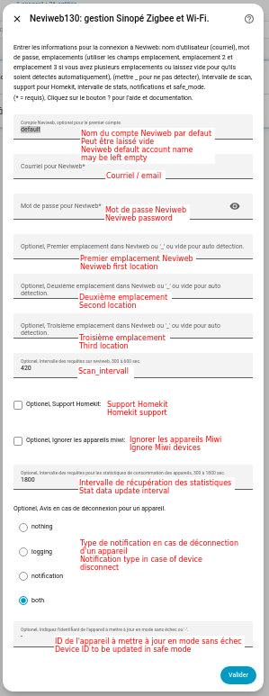
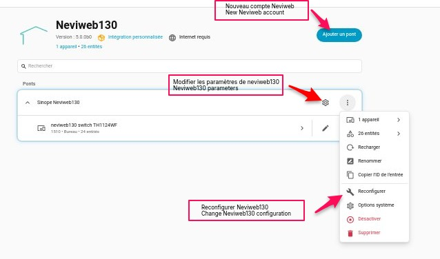
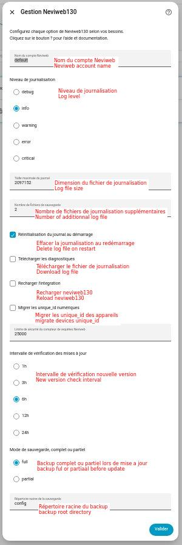
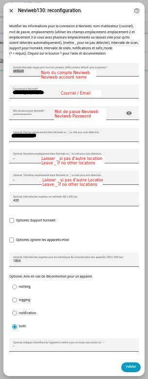
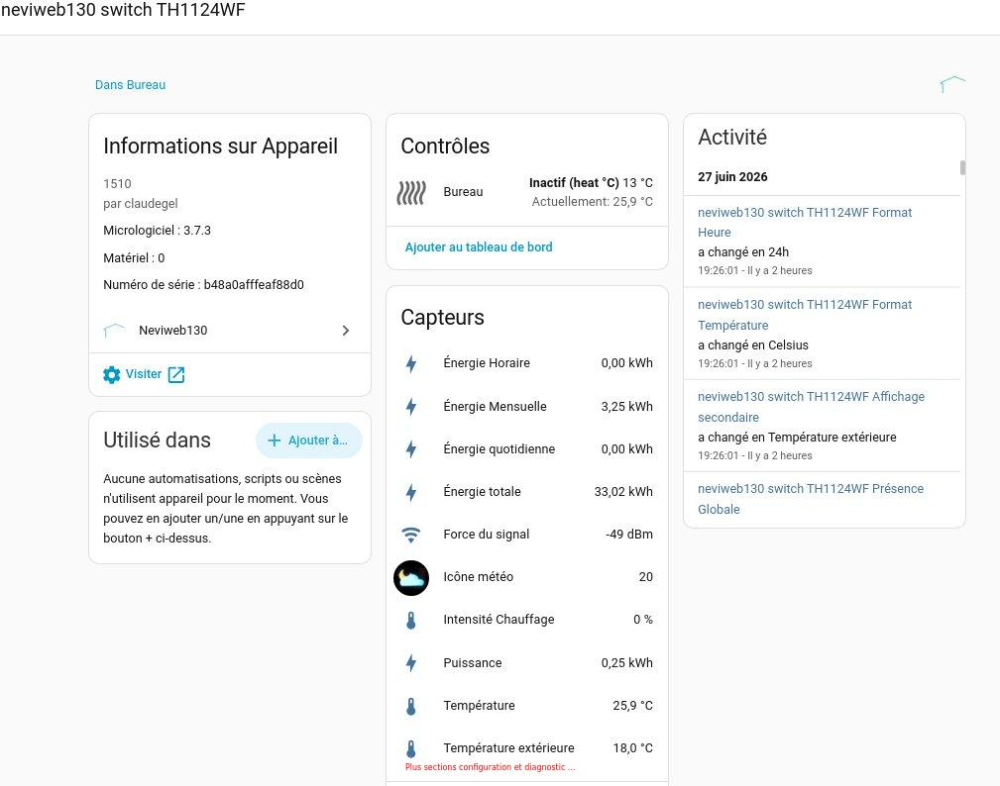
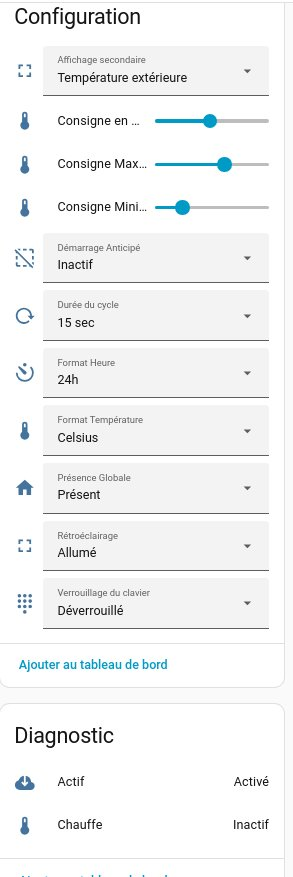
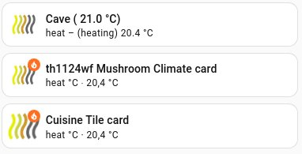
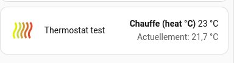

## Home Assistant Neviweb130 Custom Components
[🇬🇧 English version](../README.md)
> 💛 **Vous aimez cette integration?**  
> Si vous voulez supporter son développement, vous pouvez contribuer ici:
> [](https://www.paypal.me/phytoressources/)  ou
> [](Donations.md)

Intégration personnalisée pour utiliser les appareils [Neviweb](https://neviweb.com/) dans [Home Assistant](http://www.home-assistant.io) (HA).
Neviweb est la plateforme de Sinopé Technologies pour ses appareils intelligents : thermostats, interrupteurs et gradateurs, contrôleurs de charge, prises, valves, détecteurs de fuite d’eau et autres.

Neviweb130 (Sinope Neviweb130 dans HACS) gère les appareils Zigbee connectés à Neviweb par la passerelle GT130, et les appareils Wi-Fi connectés directement à Neviweb. Il est presque à jour avec Neviweb, mais certaines informations manquent encore chez Sinopé. Les nouveaux appareils Sinopé sont ajoutés à mesure qu’ils sortent. Si votre appareil n’est pas encore pris en charge, ouvrez une issue et il sera ajouté rapidement.

Signaler un problème ou proposer une amélioration : [Créer une issue](https://github.com/claudegel/sinope-130/issues/new/choose)

## Table des matières

- [Appareils pris en charge](#appareils-pris-en-charge)
- [Prérequis](#prérequis)
- [Installation](#installation)
- [Configuration](#configuration)
- [Migration depuis la version 4.x](#migration-depuis-la-version-4x)
- [Valve Sedna](#valve-sedna)
- [GT130](#passerelle-gt130)
- [Système de mise à jour](#système-de-mise-à-jour)
- [Compteur de requêtes](#compteur-de-requêtes-quotidiennes-neviweb)
- [Services / Actions](#services-personnalisés-actions)
- [Éco-Sinopé](#capter-le-signal-éco-sinopé-pour-les-périodes-de-pointe)
- [Statistiques d'énergie](#statistiques-dénergie-et-deau)
- [Localisation (langue)](#localisation)
- [Dépannage](#dépannage)
- [Personnalisation](#personnalisation)
- [Réinitialisation de l'appareil](#réinitialisation-matérielle-de-lappareil)
- [À faire](#à-faire)

## Appareils pris en charge
Voici une liste des appareils actuellement pris en charge. En gros, c'est tout ce qui peut être ajouté dans Neviweb.
- **thermostats Zigbee**:
  - Sinopé TH1123ZB, thermostat de ligne 3000W
  - Sinopé TH1124ZB, thermostat de ligne 4000W
  - Sinopé TH1123ZB, thermostat de ligne pour aires publiques 3000W
  - Sinopé TH1124ZB, thermostat de ligne pour aires publiques 4000W
  - Sinopé TH1123ZB-G2, thermostat deuxième génération 3000W
  - Sinopé TH1124ZB-G2, thermostat deuxième génération 4000W
  - Sinopé TH1134ZB-HC, pour le contrôle du verrouillage chauffage/refroidissement
  - Sinopé TH1300ZB, thermostat de chauffage au sol 3600W
  - Sinopé TH1320ZB-04, thermostat de chauffage au sol
  - Sinopé TH1400ZB, thermostat basse tension
  - Sinopé TH1500ZB, thermostat bipolaire 3600W
  - Nordik TH1420ZB-01, thermostat de plancher hydroponique radiant basse tension Nordik
  - Ouellet OTH3600-GA-ZB, thermostat de plancher Ouellet
  - Ouellet OTH4000-ZB, thermostat basse tension Ouellet 4000W
- **thermostats Wi-Fi** (pas besoin de GT130):
  - Sinopé TH1124WF Wi-Fi, thermostat de ligne 4000W
  - Sinopé TH1123WF Wi-Fi, thermostat de ligne 3000W
  - Sinopé TH1133WF Wi-Fi, thermostat à tension de ligne – édition Lite 3000W
  - Sinopé TH1133CR, thermostat à tension de ligne – édition Lite Sinopé Evo 3000w
  - Sinopé TH1134WF Wi-Fi, thermostat à tension de ligne – édition Lite 4000W
  - Sinopé TH1134CR, Thermostat à tension de ligne – édition Lite Sinopé Evo 4000w
  - Sinopé TH1143WF, thermostat à deux fils, écran couleur Wi-Fi 3000W
  - Sinopé TH1144WF, thermostat à deux fils, écran couleur WI-Fi 4000W
  - Sinopé TH1145WF, thermostat à deux fils, écran couleur Wi-Fi 4000W
  - Sinopé TH1300WF, thermostat au sol Wi-Fi 3600W
  - Sinopé TH1310WF, thermostat au sol Wi-Fi 3600W
  - Sinopé TH1315WF, thermostat au sol W--Fi, sans capteur de mesure de consommation d'énergie, seulement une consommation calculée
  - Sinopé TH1325WF, thermostat au sol Wi-Fi 3600W
  - Sinopé TH1400WF, thermostat basse tension Wi-Fi 
  - Sinopé TH1500WF, thermostat bipolaire Wi-Fi 3600W 
  - Sinopé TH6500WF, thermostat Wi-Fi chauffage/climatisation
  - Sinopé TH6510WF, thermostat Wi-Fi chauffage/climatisation
  - Sinopé TH6250WF, thermostat Wi-Fi chauffage/climatisation
  - Sinopé TH6250WF-PRO, thermostat Wi-Fi chauffage/climatisation PRO
  - Sinopé TH6251WF-PRO, thermostat Wi-Fi chauffage/climatisation PRO
  - Sinopé THEWF01, thermostat de ligne, édition lite Wi-Fi
  - Flextherm concerto connect FLP55 thermostat de sol (sku FLP55 ne fourni pas de statistique énergétique dans Neviweb)
  - Flextherm True Comfort, thermostat de sol
  - SRM40, thermostat de sol
- **Contrôleur de pompe à chaleur**:
  - Sinopé HP6000ZB-GE, pour les thermopompes Ouellet avec connecteur Gree
  - Sinopé HP6000ZB-GE-RS485 pour les thermopompes Tosot avec connecteur Gree
  - Sinopé HP6000ZB-MA, pour les thermopompes Ouellet, Convectair avec connecteur Midea
  - Sinopé HP6000ZB-HS, pour les thermopompes Hisense, Haxxair et Zephyr
- **Contrôleur de pompe à chaleur Wi-Fi**:
  - Sinopé HP6000WF-MA, pour les thermopompes Ouellet, Convectair avec connecteur Midea
  - Sinopé HP6000WF-HA, pour les thermopompes Hotpoint
  - Sinopé HP6000WF-TCL, pour les thermopompes Runtru/Ameristar et Nirvana
- **éclairage Zigbee**:
  - Sinopé SW2500ZB, Interrupteur
  - Sinopé SW2500ZB-G2, Interrupteur nouvelle génération
  - Sinopé DM2500ZB, gradateur
  - Sinopé DM2500ZB-G2, gradateur nouvelle génération
  - Sinopé DM2550ZB, gradateur
  - Sinopé DM2550ZB-G2, gradateur
- **éclairage Zigbee connecté directement à la valve Sedna**:
  - Sinopé SW2500ZB-VA, Interrupteur
  - Sinopé DM2500ZB-VA, gradateur
  - Sinopé DM2550ZB-VA, gradateur
- **Contrôle spécialisé Zigbee**:
  - Sinopé RM3250ZB, Contrôleur de charge 50A
  - Sinopé RM3500ZB, Contrôleur de charge Calypso pour chauffe-eau 20,8A 
  - Sinopé SP2610ZB, prise murale
  - Sinopé SP2600ZB, prise portable intelligente
  - Sinopé MC3100ZB, multicontrôleur pour système d'alarme et valve Sedna
- **Contrôle spécialisé Zigbee connecté directement à la valve Sedna**:
  - Sinopé RM3250ZB-VA, Contrôleur de charge 50A 
  - Sinopé SP2610ZB-VA, prise murale
  - Sinopé SP2600ZB-VA, prise portable intelligente
  - Sinopé MC3100ZB-VA, multicontrôleur pour système d'alarme et valve Sedna
- **Contrôle spécialisé Wi-Fi**:
  - Sinopé RM3500WF, Contrôleur de charge pour chauffe-eau, Wi-Fi
  - Sinopé RM3510WF, Contrôleur de charge pour chauffe-eau, Wi-Fi
  - Sinopé RM3250WF, Contrôleur de charge 40A, Wi-Fi
- **Water leak detector and valves**:
  - Sinopé VA4201WZ, VA4221WZ, valve sedna 1 pouce
  - Sinopé VA4200WZ, VA4220WZ, valve sedna 3/4 pouce, Wi-Fi
  - Sinopé VA4200ZB, valve sedna 3/4 pouce Zigbee
  - Sinopé VA4220WZ, valve sedna 2e gen 3/4 pouce
  - Sinopé VA4220WF, valve sedna 2e gen 3/4 pouce, Wi-Fi
  - Sinopé VA4220ZB, valve sedna 2e gen 3/4 pouce, Zigbee
  - Sinopé VA4221WZ, valve sedna 2e gen 1 pouce
  - Sinopé VA4221WF, valve sedna 2e gen 1 pouce, Wi-Fi
  - Sinopé VA4221ZB, valve sedna 2e gen 1 pouce, Zigbee
  - Sinopé WL4200,   détecteur de fuite
  - Sinopé WL4200S,  détecteur de fuite avec sonde déportée
  - Sinopé WL4200C,  cable de périmètre détecteur de fuite
  - Sinopé WL4200ZB, détecteur de fuite
  - Sinopé WL4210,   détecteur de fuite
  - Sinopé WL4210S,  détecteur de fuite avec sonde déportée
  - Sinopé WL4210C,  cable de périmètre détecteur de fuite
  - Sinopé WL4210ZB, détecteur de fuite
  - Sinopé WL4200ZB, détecteur de fuite connecté à la valve Sedna
  - Sinopé ACT4220WF-M, VA4220WF-M, valve sedna multi-residentiel maitre valve 2e gen 3/4 pouce, Wi-Fi
  - Sinopé ACT4220ZB-M, VA4220ZB-M, valve sedna multi-residentiel secondaire valve 2e gen 3/4 pouce, Zigbee
  - Sinopé ACT4221WF-M, VA4221WF-M, valve sedna multi-residentiel maitre valve 2e gen. 1 pouce, Wi-Fi
  - Sinopé ACT4221ZB-M, VA4221ZB-M, valve sedna multi-residentiel secondaire valve 2e gen. 1 pouce, Zigbee
- **Capteur de débit**: (pris en charge comme attribut pour les valves Sedna de 2e génération)
  - Sinopé FS4220, capteur de débit 3/4 pouce
  - Sinopé FS4221, capteur de débit 1 pouce
- **Moniteur de niveau de réservoir**:
  - Sinopé LM4110-ZB, Moniteur de niveau de réservoir de propane
  - Sinopé LM4110-LTE, Moniteur de niveau de réservoir de propane LTE
- **Passerelle**:
  - GT130
  - GT4220WF et GT4220WF-M, passerelle mesh pour les valves
- **Alimentation**:
  - Sinopé ACUPS-01, batterie de secours pour valve Sedna, GT130 ou GT125
 
## Prérequis
Vos appareils doivent être ajoutés à votre portail Neviweb avant de pouvoir les utiliser dans Home Assistant :
- les appareils Zigbee par une passerelle GT130,
- les appareils Wi-Fi directement,
- certains appareils Zigbee par une valve Sedna, elle-même connectée à Neviweb.

Consultez le manuel de votre appareil ou visitez [l’assistance Neviweb](https://support.sinopetech.com/).

Les appareils Wi-Fi peuvent être dans le même emplacement (réseau) Neviweb que les appareils Zigbee du GT130, ou dans un emplacement séparé. Neviweb130 gère jusqu’à trois emplacements par compte Neviweb. Le troisième emplacement doit être demandé à Sinopé.

Quatre composants personnalisés permettent de gérer les appareils Sinopé, par Neviweb ou en local :
- [**neviweb**](https://github.com/claudegel/sinope-1) (HACS : Sinope Neviweb), pour les appareils MiWi par le portail Neviweb.
- [**sinope**](https://github.com/claudegel/sinope-gt125) (HACS : Sinope GT125), pour les appareils gérés directement par votre passerelle GT125.
- [**neviweb130**](https://github.com/claudegel/sinope-130) (HACS : Sinope Neviweb130), cette intégration, pour les appareils Zigbee et Wi-Fi par le portail Neviweb.
- [**sinope-zha**](https://github.com/claudegel/sinope-zha), les nouveaux quirks Sinopé pour ZHA avant leur ajout à zha-device-handlers. Avec un coordinateur Zigbee comme la clé USB ConBee II, ZHA gère vos appareils Zigbee en local. Copiez les fichiers sinope-zha dans votre installation HA pour tester les nouveaux quirks : ZHA les charge à la place des quirks Sinopé standards.

Ils peuvent tous être utilisés en même temps. Les appareils Zigbee gérés directement par ZHA doivent être retirés de Neviweb, car un appareil ne peut pas être sur deux réseaux Zigbee en même temps.

## Installation
### Composant personnalisé Neviweb130 pour gérer votre appareil via le portail Neviweb
Il existe deux méthodes pour installer ce composant personnalisé :
- **Via le composant HACS** (Home Assistant Community Store):
  - Neviweb130 est compatible avec [HACS](https://community.home-assistant.io/t/custom-component-hacs/121727).
  - Après avoir installé HACS, installez « Sinope neviweb-130 » (neviweb130) depuis le magasin et utilisez l'exemple configuration.yaml
    ci-dessous.
    
- **Manuellement via téléchargement direct**:
  - Téléchargez le fichier zip de ce référentiel en utilisant le bouton de téléchargement vert en haut à droite.
  - Extrayez le fichier zip sur votre ordinateur, puis copiez l'intégralité du dossier « custom_components » dans votre Home Assistant 
    Répertoire `config` (où vous pouvez trouver votre fichier `configuration.yaml`).
  - Votre répertoire de configuration devrait ressembler à ceci :
 
   ```
    config/
      configuration.yaml
      custom_components/
        neviweb130/
          translations/
            en.json
            fr.json
          __init__.py
          climate.py
          const.py
          helpers.py
          light.py
          manifest.json
          schema.py
          sensor.py
          services.yaml
          strings.json
          switch.py
          update.py
          valve.py
    ```

- **Installation Neviweb130-V2**
  La version V2 sera installé via une simple mise à jour de Neviweb130 vers la version v5.0.0.  Il faut faire un backup avant car V2
  change complètement la méthode de fonctionnement de Neviweb130. Le module de mise à jour de Neviweb130 permet de faire un backup avant
  la mise à jour.

  Pour ceux qui veulent tester la nouvelle version V2, il est possible de copier les fichiers de la version V2 de la branche
  **Neviweb130-V2**. Il y a beaucoup plus de fichiers car le fonctionnement de Neviweb130-V2 est complètement différent de la version V1.
  Vous pouvez copier tous les fichiers V2  dans le répertoire V1 ou les installer sur un machine de test indépendante.

  Votre repertoire V2 ressemblera a ceci:
  ```
    config/
      configuration.yaml
      custom_components/
        neviweb130/
          translations/
            en.json
            fr.json
          __init__.py
          binary_sensor.py
          button.py
          climate.py
          config_flow.py
          const.py
          coordinator.py
          devices.py
          helpers.py
          light.py
          manifest.json
          number.py
          schema.py
          select.py
          sensor.py
          services.yaml
          session_manager.py
          strings.json
          switch.py
          update.py
          valve.py
    ```

## Configuration

Neviweb130 se configure dans l’interface de Home Assistant. La configuration dans `configuration.yaml` est obsolète. Si vous passez de la version 4.x, voir [Migration depuis la version 4.x](#migration-depuis-la-version-4x).

### Ajouter un compte Neviweb

Allez dans Paramètres → Appareils et services. Au bas de la page, cliquez sur **Ajouter une intégration** et cherchez **Sinope Neviweb130**. Une fenêtre s’ouvre pour entrer vos paramètres de connexion Neviweb.



Neviweb130 se charge ensuite et commence à récupérer vos appareils Neviweb.

Pour gérer un autre compte Neviweb, ajoutez l’intégration de nouveau avec un **prefix** différent.

### Paramètres

Les noms d’emplacements sont ceux affichés en haut de la première page après la connexion à Neviweb. Si vous avez plusieurs emplacements, cliquez sur l’icône en haut pour les voir tous. Les appareils Zigbee (GT130) et Wi-Fi d’un même groupe doivent être dans le même emplacement. Les appareils MiWi (GT125) ne sont pas supportés. Pour eux, installez le composant [Neviweb](https://github.com/claudegel/sinope-1), qui peut fonctionner en même temps que celui-ci.


| clé               | requis | défaut                 | description                                                                                                                                                       |
|-------------------|--------|------------------------|-------------------------------------------------------------------------------------------------------------------------------------------------------------------|
| **prefix**        | non    | default                | Nom du compte Neviweb. Utile seulement si vous ajoutez plus d’un compte. Chaque compte doit avoir un préfixe différent, sans espace ni accent.                     |
| **username**      | oui    |                        | Le courriel utilisé pour vous connecter à Neviweb.                                                                                                                |
| **password**      | oui    |                        | Votre mot de passe Neviweb.                                                                                                                                       |
| **network**       | non    | 1er emplacement trouvé | Nom de l’emplacement Neviweb où sont vos appareils Zigbee ou Wi-Fi. Vide pour la détection automatique, ou `_` pour bloquer la détection.                        |
| **network2**      | non    | 2e emplacement trouvé  | Nom du deuxième emplacement. Vide si vous n’en avez qu’un.                                                                                                        |
| **network3**      | non    | 3e emplacement trouvé  | Nom du troisième emplacement. Vide si vous n’en avez qu’un ou deux.                                                                                               |
| **scan_interval** | non    | 420                    | Secondes entre deux lectures de l’état des appareils dans Neviweb, de 300 à 600. Sinopé demande au moins 5 minutes. Au-delà de 600, la session expire.           |
| **homekit_mode**  | non    | False                  | Ajoute les valeurs propres à HomeKit. Inutile si vous n’utilisez pas HomeKit.                                                                                    |
| **ignore_miwi**   | non    | False                  | À mettre à True si un emplacement choisi contient aussi des appareils MiWi (GT125). Sinon, un avertissement indique que l’emplacement contient des appareils MiWi. |
| **stat_interval** | non    | 1800                   | Secondes entre deux lectures des statistiques d’énergie dans Neviweb, de 300 à 1800.                                                                              |
| **notify**        | non    | both                   | Façon de signaler les erreurs d’appareil : `nothing`, `logging`, `notification` ou `both`.                                                                        |
| **safe_mode**     | non    | -                      | ID d’appareils séparés par des virgules à lire en mode sécuritaire, ou `-`. Les attributs non supportés par le micrologiciel sont ignorés. Un appareil qui retourne `DVCATTRNSPTD` est ajouté automatiquement et une notification est envoyée. |

Si vous avez aussi un GT125 dans Neviweb, entrez le nom de l’emplacement, sinon l’emplacement du GT125 pourrait être pris par erreur. Les emplacements inutilisés peuvent rester vides, ou être mis à `_` pour que Neviweb130 ne les cherche pas. Un troisième emplacement doit être activé par Sinopé. Si vous entrez des noms, écrivez-les exactement comme dans Neviweb, majuscules comprises. Les lettres accentuées sont refusées.

### Gérer l’intégration

Tout se trouve dans Paramètres → Appareils et services → Neviweb130 :



Vous pouvez y :
- ajouter un autre compte Neviweb,
- changer les options de l’intégration avec **Configurer** (voir [doc/options.md](options.md)),
- changer les paramètres du compte avec **Reconfigurer**.

Les changements s’appliquent sans redémarrer Home Assistant : Neviweb130 se recharge lui-même. Un gestionnaire de session ferme et rouvre les connexions Neviweb au besoin, ce qui évite les erreurs ACCSESSEXC lors de redémarrages fréquents de Home Assistant.

*Options de configuration disponibles* :



*Reconfiguration* :



### Options de l’intégration

- **prefix** : nom du compte Neviweb.
- **log_level**, **log_max_bytes**, **log_backup_count**, **log_reset_on_start** : réglages du fichier de log de neviweb130 (voir Dépannage).
- **download_log** : copie le fichier de log vers `/local/neviweb130.log` pour le télécharger. La copie est effacée après 30 minutes.
- **reload** : recharge neviweb130 sans redémarrer Home Assistant.
- **migrate** : relance la conversion des anciens unique_id numériques en texte.
- **request_limit** (défaut 25000) : limite de sécurité des requêtes par jour. La limite de Neviweb est de 30000. Une notification est envoyée au-delà.
- **update_check_interval** (1h, 3h, 6h, 12h ou 24h, défaut 6h) : fréquence de vérification des nouvelles versions sur GitHub.
- **backup_mode** (full ou partial) et **backup_folders** (défaut `config`) : sauvegarde faite avant l’installation d’une mise à jour. Nécessite une installation Home Assistant avec le Supervisor.

### Entités d’attributs

Chaque appareil a sa page dans Paramètres → Appareils et services → Neviweb130, et Neviweb130 crée une entité pour la plupart des attributs :
- sensor, pour les valeurs numériques comme la température, la tension et les statistiques d’énergie,
- binary_sensor, pour les états on/off comme les détecteurs de fuite,
- button, pour réinitialiser un attribut on/off ou une alarme,
- number, pour changer une valeur numérique (température minimum/maximum, température d’absence, etc.),
- switch, pour activer ou désactiver un attribut,
- select, pour les attributs à choix multiples. Les choix sont traduits et convertis automatiquement vers et depuis les valeurs Neviweb.

Ces entités se mettent à jour avec l’appareil et s’utilisent directement dans les automatisations et le tableau de bord Énergie. Les capteurs template sur les attributs ne sont plus nécessaires. Les entités, services et attributs sont traduits en français ou en anglais selon la langue de Home Assistant. S’il manque une entité d’attribut, ouvrez une issue.

Exemple de page d’appareil :




## Migration depuis la version 4.x

Au premier démarrage de la version 5, Neviweb130 :
- importe la configuration `neviweb130:` de `configuration.yaml` dans la configuration par l’interface,
- convertit les `unique_id` en texte (int vers str),
- convertit les numéros de modèle des appareils en texte (int vers str).

Ces changements sont requis par Home Assistant et se font automatiquement. Les noms d’appareils sont conservés et les attributs restent accessibles.

Après le premier démarrage :
- retirez ou commentez le bloc `neviweb130:` de `configuration.yaml`,
- vérifiez vos automatisations, scripts et tableaux de bord. Ils continuent de fonctionner, mais les nouvelles entités d’attributs peuvent remplacer vos capteurs template,
- les icônes des appareils sont fournies par l’intégration avec l’attribut `icon_type` et l’image de l’entité (voir [Personnalisation](#personnalisation)), Custom-UI n’est plus nécessaire.

<details>
<summary>Référence de l’ancienne configuration configuration.yaml (version 4.x)</summary>

#### Un seul compte

```yaml
# Exemple d'entrée dans configuration.yaml 
neviweb130:
  username: '«your Neviweb username»'
  password: '«your Neviweb password»'
  network: '«your gt130 location name in Neviweb»'   # gt130 emplacement dans Neviweb
  network2: '«your second location name in Neviweb»' # 2e emplacement
  network3: '«your third location name in Neviweb»'  # 3e emplacement
  scan_interval: 360
  homekit_mode: False
  ignore_miwi: False
  stat_interval: 1800
  notify: "both"
  safe_mode: "-"
```

#### Configuration multi-comptes
(nouveau depuis la version 3.1.0)

Si vous devez contrôler des appareils à partir de **plusieurs comptes Neviweb** (par exemple, votre maison et celle d'un voisin), vous pouvez 
désormais utiliser le nouveau format de configuration multi-comptes. Cela élimine le besoin de dupliquer le dossier des composants personnalisés.

```yaml
# Exemple de configuration multi-comptes
neviweb130:
  accounts:
    # Compte avec plusieurs emplacements (ex: maison et chalet)
    - username: 'your_email@example.com'
      password: 'your_password'
      # l'emplacement (location) était appelé réseau dans les versions précédentes.
      #
      # Optionel: vous pouvez cibler jusqu'à trois emplacements pour ce compte:
      #   location / location2 / location3 (ou network / network2 / network3)
      #
      # Si vous omettez tous les emplacements, l'intégration utilisera automatiquement les 1 à 3 premiers emplacements
      # retourné par Neviweb pour ce compte.
    
    # Compte séparé pour les parents (en utilisant `network` - fonctionne de la même manière que `location`)
    - username: 'parents_email@example.com'
      password: 'parents_password'
      location: '5678'           # Optionel: location id/name (ou utiliser 'network')
      prefix: 'parents'          # Optionel: pseudonyme de compte (utilisé dans la dénomination des entités)
  
  # Paramètres globaux (s'appliquent à tous les comptes)
  scan_interval: 360
  homekit_mode: False
  ignore_miwi: False
  stat_interval: 1800
  notify: "both"
  safe_mode: "-"
```
Les paramètres sont en anglais. Il ne faut pas les traduire.

> **⚠️ Important : Conflits de noms d'entité dans la configuration multi-comptes**
> 
> Les noms d'entités sont construits à partir du domaine d'intégration (`neviweb130`), plus des valeurs facultatives de `prefix` et/ou `location` (emplacement).
> 
> **Problème :** Si vous omettez à la fois « préfixe » et « emplacement » pour plusieurs comptes et que les deux comptes ont des appareils avec des noms
> similaires (par exemple, les deux ont un thermostat appelé « LivingRoom »), Home Assistant peut suffixer automatiquement les identifiants d'entité :
> - `climate.neviweb130_livingroom`
> - `climate.neviweb130_livingroom_2` ← Collision gérée par HA
> 
> **Solution :** Fournissez soit un « préfixe » unique (alias de compte), soit des noms/identifiants d'« location » (emplacement) explicites, pour que les
> identifiants d'entité restent stables et lisibles :
> ```yaml
> accounts:
>   - username: 'user1@example.com'
>     password: 'pass1'
>     location: 'Home'
>     prefix: 'me'          # ← alias de compte Neviweb
>   - username: 'user2@example.com'
>     password: 'pass2'
>     location: 'Chalet'
>     prefix: 'parents'     # ← autre alias de compte Neviweb
> ```
> Example: `climate.neviweb130_parents_chalet_climate_livingroom`.

**Options de configuration Multi-comptes:**

| clé | requis | défaut | description
| --- | --- | --- | ---
| **accounts** | oui (pour multi-comptes) | | Liste des comptes auxquels se connecter
| **username** | oui | | Votre adresse email pour ce compte Neviweb
| **password** | oui | | Le mot de passe de ce compte Neviweb
| **location** (ou **network**) | non | premier emplacement trouvé | Identifiant/nom d'emplacement pour ce compte (réseau n° 1).
| **location2** (ou **network2**) | non | deuxième emplacement trouvé | Identifiant/nom d'emplacement pour ce compte (réseau n° 2).
| **location3** (ou **network3**) | non | troisième emplacement trouvé | Identifiant/nom d'emplacement pour ce compte (réseau n° 3).
| **prefix** | non | (vide) | Alias ​​de compte facultatif utilisé dans la dénomination de l’entité pour distinguer les comptes.

**Notes:**
- `préfixe` est facultatif. S'il est omis, il n'est pas inclus dans le nom de l'entité (Home Assistant peut suffixer automatiquementent
  les entités si des collisions se produisent).
- Si les noms/identifiants de votre « emplacement » sont déjà uniques dans vos comptes (par exemple, vous utilisez une adresse, un code
  de site ou une autre étiquette unique), vous pouvez omettre entièrement le « préfixe » et vous fier à « l'emplacement » pour distinguer
  les entités.
- Chaque compte maintient sa propre connexion indépendante à Neviweb.
- **Plusieurs emplacements par compte**:
  - Si vous omettez tous les emplacements, l'intégration utilisera automatiquement les 1 à 3 premiers emplacements renvoyés par Neviweb.
  - Ou vous pouvez définir explicitement « location2 » et « location3 ».
- "location*" et "network*" sont tous deux acceptés comme alias dans le nouveau format par souci de cohérence avec l'ancien format.
- Les paramètres globaux (`scan_interval`, `homekit_mode`, etc.) s'appliquent à tous les comptes.
- L'ancien format de configuration à compte unique (illustré ci-dessus) reste entièrement pris en charge pour une compatibilité ascendante.

**Exemple de nom d'entité:**
- **Ancienne configuration à compte unique (dénomination rétrocompatible)**:
  - 1er emplacement → `climate.neviweb130_climate_room`
  - 2ème emplacement → `climate.neviweb130_climate_2_room`
  - 3ème emplacement → `climate.neviweb130_climate_3_room`
- **Configuration multi-comptes (`comptes :`)**:
  - Avec préfixe + localisation → `climate.neviweb130_parents_chalet_climate_living_room`
  - Avec localisation uniquement (pas de préfixe) → `climate.neviweb130_chalet_climate_living_room`

#### Execution de plusieurs instances de neviweb130 pour gerer differents comptes Neviweb.
> Cette section fonctionne toujours mais comme Neviweb130 prend désormais directement en charge le multi-compte, elle devient obsolète.
>
>Il est possible d'exécuter deux instances de neviweb130, mais vous devez utiliser deux comptes Neviweb different avec un nom d'utilisateur 
>(e-mail) et mot de passe différents pour chacun pour vous connecter à Neviweb.
>
>Étapes pour y parvenir :
>- Créez un autre répertoire dans config/custom_components ex. **neviweb131**.
>- Copiez tous les fichiers du répertoire neviweb130 vers le nouveau répertoire neviweb131.
>- Dans neviweb131, éditez le fichier manifest.json pour changer la ligne #2, "domain": "neviweb130",
>et remplacez-le par le même nom que le répertoire que vous venez de créer. **"domaine": "neviweb131"**,
>- Ajoutez une deuxième configuration dans configuration.yaml comme ceci :
>```yaml
># Exemple de configuration.yaml pour une deuxième instance appelée neviweb131.
>neviweb131:
>   username: 'Votre courriel pour le deuxième compte Neviweb'
>   password: 'Votre mot de passe pour le deuxième compte Neviweb'
>   network: 'Le nom d'emplacement pour votre gt130 dans ce deuxième compte Neviweb'
>   network2: 'Votre deuxième emplacement' (2e location), facultatif
>   network3: 'Votre troisième emplacement' (3e location), facultatif
>   scan_interval: 360
>   homekit_mode: False
>   ignore_miwi: False
>   stat_interval: 1800
>   notify: "both"
>```
>- Redémarrer Home Assistant.
>
>Tous les appareils de cette deuxième instance porteront un nom tel que `climat.neviweb131_climate_office_thermostat`.

</details>

## Valve Sedna
Pour les valves Sedna, il existe deux façons de les connecter à Neviweb :
- Via connexion Wi-Fi directe. De cette façon, les capteurs de fuite sont connectés directement à la valve Sedna qui se fermera en cas de fuite. 
- via GT130 en mode Zigbee. De cette façon, les capteurs de fuite sont également connectés au GT130 mais lors de la détection de fuite,
  rien transmis à la valve. Vous devrez définir une règle d'automatisation dans Neviweb ou HA, pour que la valve Sedna se ferme en cas de fuite 
  détecté par le capteur.

Les deux modes sont pris en charge par ce composant personnalisé.

## Passerelle GT130
Le capteur binaire `gateway_status` du GT130 indique s’il est en ligne ou hors ligne dans Neviweb.

## Système de mise à jour

Neviweb130 a sa propre entité de mise à jour :
- **Vérification des mises à jour**, toutes les 6 heures par défaut (option update_check_interval). Elle détecte les nouvelles versions, les préversions (versions contenant b0, -beta, rc1, etc.) et les changements incompatibles trouvés dans les notes de version. Les préversions et les changements incompatibles ont une icône spéciale et une mention dans le titre de la carte de mise à jour.
- **Validation SHA-256** : le fichier zip de la mise à jour est comparé au SHA-256 officiel de GitHub. S’ils diffèrent, la mise à jour est annulée et vous êtes avisé.
- **Retour arrière automatique** : si une erreur survient pendant la mise à jour, l’ancienne version est restaurée et vous êtes avisé.
- **Sauvegarde** : une sauvegarde est faite avant la mise à jour, selon les options backup_mode et backup_folders (voir [Options de l’intégration](#options-de-lintégration)).
- **Notifications** en cas de succès, d’échec avec retour arrière et d’erreur SHA-256.
- **Notes de version** : un lien sur la carte de mise à jour ouvre les notes de version sur GitHub.

L’entité de mise à jour a aussi ces attributs :
- check_interval : valeur de l’option update_check_interval (défaut 6h),
- last_check et next_check : date et heure de la dernière et de la prochaine vérification,
- last_update_success : date et heure de la dernière mise à jour réussie,
- update_status : étapes effectuées pendant la mise à jour,
- rollback_status : résultat du retour arrière si une mise à jour a échoué,
- update_percentage : progression de la mise à jour.

Pour éviter deux cartes de mise à jour (une de HACS, une de Neviweb130), masquez celle de HACS :
1. Allez dans Paramètres → Appareils et services → HACS.
2. Sur la ligne Sinope Neviweb130, désactivez l’option préversion si elle est active.
3. Cliquez sur le menu à trois points au bout de la ligne, puis sur **2 entités**.
4. Choisissez l’entité de mise à jour, cliquez sur le bouton de paramètres et désactivez **Visible**.

Vous pouvez toujours mettre à jour ou retélécharger Neviweb130 manuellement par HACS. Vous pouvez aussi faire l’étape 4 à partir de la carte de mise à jour de HACS la prochaine fois qu’elle apparaît.

## Compteur de requêtes quotidiennes Neviweb
Neviweb limite chaque compte à 30000 requêtes par jour. Au-delà, vous êtes déconnecté jusqu’à minuit, ce qui pose problème avec beaucoup d’appareils ou pendant le développement.

Neviweb130 compte ses requêtes quotidiennes (mises à jour, statistiques, vérifications d’erreurs, etc.) dans le capteur `sensor.neviweb130_daily_requests`. Le compte survit aux redémarrages de HA et revient à 0 à minuit. Il aide à choisir un scan_interval plus court sans dépasser la limite. Une notification est envoyée quand le compte dépasse l’option request_limit (défaut 25000).

## Services personnalisés (actions)

Les automatisations nécessitent que les services (actions) puissent envoyer des commandes. Ex. `light.turn_on`. Pour les appareils Sinopé 
connectés via neviweb130, il est possible d'utiliser des services personnalisés pour envoyer des informations spécifiques aux appareils 
ou pour changer certains paramètres des appareils. Ces services personnalisés sont accessibles via des `outils de développement` ou peuvent 
être utilisés dans les automatisations suivantes:
- neviweb130.set_second_display, permet de modifier le réglage du deuxième affichage du thermostat de la température de consigne à 
  température extérieure. Celui-ci ne doit être envoyé qu’une seule fois à chaque appareil.
- neviweb130.set_climate_keypad_lock, permet de verrouiller le clavier de l'appareil.
- neviweb130.set_light_keypad_lock, permet de verrouiller le clavier du dispositif d'éclairage.
- neviweb130.set_switch_keypad_lock, permet de verrouiller le clavier de l'appareil switch.
- neviweb130.set_light_timer, ceci est utilisé pour régler une minuterie en secondes (0 à 10800) pour que les appareils d'éclairage s'éteignent après 
  ce délais.
- neviweb130.set_switch_timer, ceci est utilisé pour régler une minuterie en secondes (0 à 10800) pour les appareils switch et multi 
  contrôleur pour s'éteindre après ce délai.
- neviweb130.set_switch_timer2, ceci est utilisé pour régler le timer2 en secondes (0 à 10800) sur le switch multi contrôleur 
  l'appareil doit s'éteindre après ce délai.
- neviweb130.set_led_indicator, cela permet de changer la couleur et l'intensité du voyant LED sur les appareils lumineux pour « on » et 
  état « éteint ». vous pouvez envoyer n'importe quelle couleur de la liste RVB via les trois paramètres de couleur rouge, vert et bleu, et vous pouvez 
  régler l'intensité de l'indicateur LED.
- neviweb130.set_time_format, pour afficher l'heure en format 12h ou 24h sur les thermostats.
- neviweb130.set_temperature_format, pour afficher la température au format Celsius ou Fahrenheit sur les thermostats.
- neviweb130.set_backlight, pour régler l'intensité du rétroéclairage en état « on » ou « off » pour les thermostats.
- neviweb130.set_wattage, pour définir wattageOverload pour les appareils d'éclairage.
- neviweb130.set_auxiliary_load, pour définir l'état et la charge du chauffage d'appoint.
- neviweb130.set_setpoint_min, pour définir la température de consigne minimale pour les thermostats.
- neviweb130.set_setpoint_max, pour définir la température de consigne maximale pour les thermostats.
- neviweb130.set_cool_setpoint_min, pour définir le point de consigne de refroidissement minimum pour le TH1134ZB-HC.
- neviweb130.set_cool_setpoint_max, pour définir le point de consigne de refroidissement maximum pour le TH1134ZB-HC.
- neviweb130.set_floor_limit_low, pour définir la température de consigne minimale pour les thermostats de sol. (5 à 34°C), (0 = éteint)
- neviweb130.set_floor_limit_high, pour définir la température de consigne maximale pour les thermostats de sol. (7 à 36°C), (0 = éteint)
- neviweb130.set_sensor_leak_alert, pour régler l’alerte de fuite du détecteur de fuite.
- neviweb130.set_sensor_temp_alert, pour régler l’alerte de basse température du détecteur de fuite.
- neviweb130.set_sensor_closure_action, pour régler l’action de fermeture de la valve en cas de fuite, seulement pour les détecteurs connectés directement à la valve Sedna.
- neviweb130.set_valve_alert, pour définir l'état d'alerte de batterie faible.
- neviweb130.set_valve_temp_alert, pour définir une alerte de basse température sur la valve Sedna.
- neviweb130.set_early_start, pour activer/désactiver le chauffage anticipé pour les thermostats Wi-Fi.
- neviweb130.set_air_floor_mode, pour basculer entre le capteur de température du sol ou le capteur de température ambiante pour
  contrôler la température ambiante.
- neviweb130.set_floor_air_limit, pour régler la température limite d'air maximale du thermostat de sol.
- neviweb130.set_phase_control, pour définir le mode de contrôle de phase du gradateur DM2550ZB (inversé ou avant).
- neviweb130.set_hvac_dr_options, pour définir ou réinitialiser l'option de période de pointe (DR) dans Neviweb pour les thermostats.
- neviweb130.set_hvac_dr_setpoint, pour régler la réduction du point de consigne du thermostat pendant la période DR, 100 à -100 (°C*10). 0 sert  
  simplement à faire clignoter la petite icône sur le thermostat.
- neviweb130.set_load_dr_options, pour définir ou réinitialiser les options de période DR dans Neviweb pour le contrôleur de charge.
- neviweb130.set_cycle_output, pour définir la durée du cycle principal du thermostat basse tension en minutes.
- neviweb130.set_aux_cycle_output, pour définir la durée du cycle auxiliaire des thermostats basse tension en minutes.
- neviweb130.set_control_onoff, change l'état des sorties 1 et 2 sur le multi contrôleur d'alarme pour valve sedna.
- neviweb130.set_battery_type, définit le type de pile, alcaline ou lithium, pour le capteur de fuite d'eau.
- neviweb130.set_tank_size, pour définir la capacité du réservoir du chauffe-eau pour Calypso RM3500ZB.
- neviweb130.set_low_temp_protection, pour activer ou non la protection du chauffe-eau pour la température de l'eau minimale.
- En dessous de 45°C, le chauffage redémarre automatiquement.
- neviweb130.set_controlled_device, pour changer le nom de l'appareil contrôlé par le contrôleur de charge RM3250ZB.
- neviweb130.set_flow_meter_model, pour changer le modèle de débitmètre connecté à la valve sedna 2e gen et démarrer/arrêter la
  protection de fuite du débitmètre.
- neviweb130.set_flow_meter_delay, pour régler le délai de fuite avant la fermeture de la valve si une fuite est détectée par le débitmètre. 
- neviweb130.set_flow_meter_options, pour paramétrer l'action du débitmètre : fermer la valve (oui/non) et envoyer un message d'alerte 
  (oui/non), ou simplement ne rien faire.
- neviweb130.set_tank_type, pour définir le type de réservoir pour LM4110-ZB, propane ou mazout.
- neviweb130.set_gauge_type, pour définir le type de jauge pour LM4110-ZB sur réservoir de propane, modèle 5-95 ou 10-80.
- neviweb130.set_low_fuel_alert, pour définir la limite de niveau bas de carburant pour le réservoir de propane, 0 (off), 10, 20 ou 30 %.
- neviweb130.set_tank_height, pour régler la hauteur du réservoir de carburant pour le capteur LM4110-ZB, 0 (off), 23, 24, 35, 38, 47, 48, 50.
- neviweb130.set_fuel_alert, pour définir l'alerte de carburant, marche/arrêt pour LM4110-ZB.
- neviweb130.set_power_supply, pour définir la source d'alimentation de la valve Sedna entre la batterie, acups-01 ou les deux.
- neviweb130.set_battery_alert, pour activer/désactiver l'alerte de batterie pour le LM4110-ZB.
- neviweb130.set_input_output_names, pour définir le nom des entrées 1 et 2 et des sorties 1 et 2 du périphérique MC3100ZB.
- neviweb130.set_activation, pour activer ou bloquer la mise à jour de l'état d'un appareil sur Neviweb.
- neviweb130.set_sensor_type, pour définir la valeur du capteur 10k ou 12k pour les thermostats de sol.
- neviweb130.set_remaining_time, pour définir la valeur de l'attribut coldLoadPickupRemainingTime.
- neviweb130.set_on_off_input_delay, pour régler le délai « on » ou « off » en secondes pour les entrées 1 et 2 du MC3100ZB.
- neviweb130.set_em_heat, pour allumer/éteindre le chauffage auxiliaire pour les thermostats de sol et basse tension. Il s'agit d'un
  remplacement de `turn_aux_heat_on` ou off qui est obsolète par HA. Le fonctionnement est différent pour les appareils TH6xxxWF, où le
  mode préréglé passe à PRESET.BOOST ou revient au mode préréglé précédent lors de la mise hors tension du chauffage auxiliaire.
- neviweb130.set_display_config, pour activer/désactiver l'affichage sur le contrôleur de la pompe à chaleur.
- neviweb130.set_sound_config, pour activer/désactiver le son sur le contrôleur de la pompe à chaleur.
- neviweb130.set_heat_pump_operation_limit, pour définir la température minimale de fonctionnement de la pompe à chaleur.
- neviweb130.set_heat_lockout_temperature, pour définir la limite maximale de température extérieure pour permettre le fonctionnement
  de l'appareil de chauffage. Fonctionne différemment pour les appareils TH1123ZB-G2, TH1124ZB-G2 et de chauffage/refroidissement (TH6xxxWF).
  Chacun utilise un attribut différent.
- neviweb130.set_cool_lockout_temperature, pour définir la limite minimale de température extérieure pour permettre le fonctionnement de
  la climatisation.
- neviweb130.set_hc_second_display, pour définir l'affichage secondaire du thermostat TH1134ZB-HC.
- neviweb130.set_language, pour définir la langue d'affichage sur les thermostats TH1134ZB-HC.
- neviweb130.set_neviweb_status, pour définir le statut global de Neviweb, domicile/extérieur via le GT130.
- neviweb130.set_climate_neviweb_status, pour définir le statut global de Neviweb, domicile/extérieur via les thermostats Zigbee ou Wi-Fi.
- neviweb130.set_refuel_alert, pour recevoir une alerte lorsque le réservoir de propane est ravitaillé,
- neviweb130.set_accessory_type, pour définir le type d’accessoire (humidificateur, déshumidificateur, échangeur d’air) connecté au TH6500WF ou TH6250WF.
- neviweb130.set_schedule_mode, pour définir le mode de planification, manuel ou automatique pour le TH6500WF ou le TH6250WF.
- neviweb130.set_flow_alarm_disable_timer, pour désactiver l'alarme de débit anormal pendant une période de 1 sec. à 24 heures.
- neviweb130.set_heatcool_setpoint_delta, pour définir un delta de température entre la consigne de chauffage et la consigne de refroidissement à partir de 
  1 à 5°C en mode auto (heat/cool) pour TH6xxxWF.
- neviweb130.set_fan_filter_reminder, pour régler le délai entre chaque nettoyage du filtre du ventilateur de 1 à 12 mois, pour 
  TH6xxxWF.
- neviweb130.set_temperature_offset, pour ajuster la calibration sur le capteur de température de -2 à 2°C par incrément de 0,5°C, pour TH6xxxWF.
- neviweb130.set_aux_heating_source, pour sélectionner le type de source de chauffage d'appoint utilisé pour le TH6xxxWF.
- neviweb130.set_fan_speed, pour régler la vitesse du ventilateur, activé ou automatique pour TH6xxxWF.
- neviweb130.set_switch_temp_alert, pour régler la fonction d'envoi d'alerte de basse température pour les MC3100ZB.
- neviweb130.set_min_time_on, pour régler la durée minimale de marche avant l’arrêt (run-on) pour TH6500WF et TH6250WF.
- neviweb130.set_min_time_off, pour régler la durée minimale d’arrêt avant le redémarrage (cooldown) pour TH6500WF et TH6250WF.
- neviweb130.set_heat_interstage_delay et set_cool_interstage_delay, pour régler la durée minimale de chauffage ou de climatisation avant de passer à l’étage suivant pour TH6500WF et TH6250WF.
- neviweb130.set_heat_dissipation_time et set_cool_dissipation_time, pour régler la durée de purge en chauffage ou en climatisation pour TH6xxxWF.
- neviweb130.set_reversing_valve_polarity, pour régler la polarité de la valve d’inversion de la thermopompe pour TH6500WF et TH6250WF.
- neviweb130.set_humidity_mode, pour régler le mode de consigne d’humidité pour TH6500WF et TH6250WF.
- neviweb130.set_room_setpoint_away, pour régler la consigne d’absence des thermostats Wi-Fi.
- neviweb130.set_cool_setpoint_away, pour régler la consigne de climatisation en absence pour TH6xxxWF et HP6000WF.
- neviweb130.set_pump_protection, pour activer ou désactiver la protection de pompe des thermostats basse tension.
- neviweb130.set_led_on_intensity et set_led_off_intensity, pour régler l’intensité du voyant à l’état «on» ou «off».
- neviweb130.set_light_min_intensity, pour régler l’intensité minimale du gradateur.
- neviweb130.set_key_double_up, pour activer ou désactiver l’action du double appui vers le haut du DM2550ZB.
- neviweb130.set_switch_power_timer, pour régler la minuterie du RM3250ZB, off ou de 1 min à 24 h. L’appareil s’éteint après ce délai.

Les actions marquées « Equipment configuration should be performed by a professional » dans les outils de développement modifient le fonctionnement de l’équipement CVC. Utilisez-les seulement si vous connaissez votre installation.

## Capter le signal Éco Sinopé pour les périodes de pointe

Si vous possédez au moins un thermostat ou un contrôleur de charge inscrit au programme Éco-Sinopé, il est maintenant possible de 
capter lorsque Neviweb envoie le signal pour le démarrage de la période du préchauffage pour les thermostats ou le signal d'arrêt pour les 
contrôleurs de charge. Sept attributs ont été ajoutés pour les thermostats et trois pour le contrôleur de charge afin de savoir que la 
période de pointe est à venir et comment il est géré :

- **Pour les thermostats** :
  - **eco_status** : réglé sur « off » pendant le fonctionnement normal, allumer « on » au début de la période de préchauffage.
    C'est l'attribut à suivre pour détecter un démarrage en pointe.
  - **eco_setpoint** : réglé sur «off» pendant le fonctionnement normal, allumer «on» pendant la période de pointe si l'appareil est géré par 
    Eco-Sinopé.
  - **eco_optout** : réglé sur «off» pendant le fonctionnement normal, en période de pointe, allumer «on» si quelqu'un modifie le point de consigne 
    manuellement durant la période de pointe.
  - **eco_power_relative** : réglé sur « off » en fonctionnement normal, permet de définir une température minimale par rapport au point de consigne 
    où le thermostat s'allumera automatiquement pour la protection contre le gel.
  - **eco_power_absolute** : réglé sur « off » en fonctionnement normal, utilisé pour limiter le niveau `pi_heating_demand` entre 1 et 
    100% en période de pointe.
  - **eco_setpoint_status** : réglé sur « off » pendant le fonctionnement normal, allumez « on » si le point de consigne de l'appareil est modifié par 
    Eco-Sinopé.
  - **eco_setpoint_delta** : mis à 0 en fonctionnement normal, modifié à des valeurs comprises entre -10 et +10 en période de pointe. 
    Pour le préchauffage, la valeur est positive et pour la période de pointe, elle est négative. Il s'agit d'un delta appliqué aux 
    consigne. -10 = consigne réduite de 10°C. +2 = consigne augmentée de 2°C.

- **Pour contrôleur de charge** :
  - **eco_status** : réglé sur « off » pendant le fonctionnement normal, allumer « on » pendant la période de pointe au début de la période 
    de préchauffage. c'est l'attribut à suivre pour détecter un démarrage en pointe.
  - **eco_onoff** : réglé sur «off» pendant le fonctionnement normal, allumer «on» pendant les périodes de pointe si l'appareil est géré par 
    Eco-Sinopé. L'appareil est éteint pendant les périodes de pointe. Rien n'est fait pendant la période de préchauffage.
  - **eco_optout** : réglé sur « off » pendant le fonctionnement normal, en période de pointe, allumez « on » si quelqu'un allume l'appareil 
    en période de pointe.

- **Pour Multicontrôleur MC3100ZB** :
  - **eco_status** : réglé sur « off » pendant le fonctionnement normal, allumer « on » pendant la période de pointe au début de la période 
    de préchauffage. c'est l'attribut à suivre pour détecter un démarrage en pointe.
  - **eco_setpoint** : réglé sur « off » en fonctionnement normal, pas de changement en période de pointe si l'appareil est géré par 
    Eco-Sinopé.
  - **eco_optout** : réglé sur « off » pendant le fonctionnement normal, pendant les périodes de pointe, allumer « on » si quelqu'un change la
    valeur onoff en période de pointe.
  - **eco_power_relative** : réglé sur « off » en fonctionnement normal, utilisé pour définir une température minimale par rapport à la
    température ambiante, valeur de température à laquelle le MC3100ZB s’allumera automatiquement pour la protection contre le gel.
  - **eco_power_absolute** : réglé sur « off » en fonctionnement normal, utilisation inconnue.

Il est alors possible de réaliser une automatisation pour préparer tous les appareils HA pour la période de pointe en suivant le changement
de l'attribut eco_status de «off» à «on».

## Statistiques d’énergie et d’eau
Les appareils qui rapportent leur consommation dans Neviweb ont ces entités capteur, en kWh :
- **Énergie totale** (`total_kwh_count`, total_increasing)
- énergie **mensuelle**, **quotidienne** et **horaire** (`monthly_kwh_count`, `daily_kwh_count`, `hourly_kwh_count`, total)

Les valves Sedna 2e génération avec capteur de débit ont le même ensemble pour l’eau, en litres : **Débit total** (`total_flow_count`, total_increasing) et les comptes mensuel, quotidien et horaire (total).

Ces capteurs ont la classe energy ou water et s’ajoutent directement au tableau de bord Énergie de HA. Aucun capteur template n’est nécessaire. Les statistiques sont lues dans Neviweb toutes les `stat_interval` secondes (défaut 1800). Neviweb publie ses données avec environ deux heures de retard.

Les attributs `hourly_kwh`, `daily_kwh` et `monthly_kwh` (kWh de la dernière heure, du dernier jour et du dernier mois) restent exposés sur les entités climate, light et switch, et `hourly_flow`, `daily_flow` et `monthly_flow` sur les entités valve.

## Localisation
Neviweb130 est traduit en français et en anglais : entités, services, attributs, erreurs et notifications. La langue suit celle de Home Assistant. D’autres langues peuvent être ajoutées en traduisant le fichier `en.json` du dossier translations.

Après avoir modifié les fichiers de traduction, redémarrez Home Assistant. Recharger l’intégration ne suffit pas pour que HA charge les nouvelles traductions.

## Dépannage
si vous voyez votre appareil dans le journal, mais qu'il n'apparaît pas dans la liste des entités, vous devez ajouter le numéro de modèle de l'appareil dans le 
code. Ou vous pouvez m'envoyer le numéro de modèle afin que je puisse l'ajouter dans le code.

Dans le journal, recherchez les lignes :
```
[custom_components.neviweb130] Received gateway data: [{'id': 100225, 'identifier': '500b91400001f750', 'name': 'Chargeur auto', 'family': '2506',...
[custom_components.neviweb130] Received signature data: {'signature': {'model': 2506, 'modelCfg': 0, 'softBuildCfg': 0, 'softVersion': {'minor': 9, 'middle': 2, 'major': 1}, 'hardRev': 2, 'protocol': 'sinopcom'}}
```
« family » : « 2506 » et « model » : 2506 sont ce dont vous avez besoin pour trouver le numéro de modèle de votre appareil.  
Les listes de modèles sont dans `const.py` (CLIMATE_MODEL, LIGHT_MODEL, SWITCH_MODEL, VALVE_MODEL, SENSOR_MODEL). Le plus simple est d’ouvrir une issue avec le numéro de modèle.

Si vous obtenez une trace de pile liée à un composant Neviweb130 dans le journal de Home Assistant, vous pouvez  
[signaler un problème ici](https://github.com/claudegel/sinope-130/issues/new/choose)

Vous pouvez également poster sur l'un de ces forum pour obtenir de l'aide :
- https://community.home-assistant.io/t/sinope-line-voltage-thermostats
- https://community.home-assistant.io/t/adding-support-for-sinope-light-switch-and-dimmer

### Fichier de journalisation

Neviweb130 écrit tous ses messages dans son propre fichier, `neviweb130_log.txt`, dans votre répertoire de configuration (config), et non dans `home-assistant.log`. Par défaut, le fichier est vidé à chaque démarrage de l’intégration (log_reset_on_start), renommé quand il atteint 2 Mo (log_max_bytes) et 2 fichiers de rotation sont conservés (log_backup_count). Ces réglages et le niveau de journalisation sont dans les options de l’intégration.

Pour faciliter le débogage, ajoutez un extrait pertinent de ce fichier à tout problème que vous signalez.

### Activer les messages de débogage

Pour modifier le niveau de journalisation dans la V2, rendez-vous dans Paramètres / Appareils et services. Cliquez sur Neviweb130, puis sur 
l'icône en forme d'engrenage ⚙️ (configuration).
Il vous suffit ensuite de sélectionner le niveau de journalisation souhaité. Aucun redémarrage de HA n'est nécessaire.
Au même endroit, vous avez également la possibilité de télécharger votre fichier de journalisation (neviweb130_log.txt), si jamais vous 
souhaitez me l'envoyer pour faciliter le débogage. 

### Messages d'erreur reçus de Neviweb
Dans votre journal, à l'occasion, vous pouvez recevoir ces messages de Neviweb :
- ACCDAYREQMAX : Requête quotidienne maximale atteinte (« quotidienne » : 30000)... Réduire la fréquence d'interrogation (scan_interval).
- ACCSESSEXC : Plusieurs sessions ouvertes en même temps. Ceci est courant si vous redémarrez Home Assistant plusieurs fois et/ou si vous 
  ayez également une session ouverte sur Neviweb.
- ACCRATELIMIT: Limite maximale de tentatives de connexion atteinte lors de la connexion à Neviweb. Connexions trop fréquentes.
  Veuillez patienter quelques minutes avant le redémarrage de HA.
- DVCACTNSPTD : Action du périphérique non prise en charge. L'appel de service n'est pas pris en charge pour cet appareil spécifique.
- DVCATTRNSPTD : Attribut de périphérique non pris en charge. Le périphérique que vous avez installé possède un firmware plus ancien et ne prend pas en charge 
  certains attributs. Attendez la mise à jour du firmware dans Neviweb et l'erreur devrait disparaître ou signalez un problème afin que nous puissions mettre un 
  exception dans le code.
- DVCBUSY : Neviweb effectue une mise à jour et les appareils ne sont pas disponibles. Essayez plus tard.
- DVCCOMMTO : Délai de communication de l'appareil : l'appareil ne répond pas assez rapidement ou vous interrogez cet appareil trop
  fréquemment.
- DVCERR: L'appareil a rejeté la requête. La commande a envoyé un attribut invalide ou non défini.
- DVCNOTSYNC : L'appareil n'est pas synchronisé avec Neviweb. Vérifiez votre réseau, routeur et/ou passerelle Wi-Fi.
- DVCUNVLB : Appareil indisponible. Neviweb ne parvient pas à se connecter à des appareils spécifiques, principalement des appareils Wi-Fi. 
- MAINTENANCE : Accès Neviweb temporairement bloqué pour maintenance... Réessayez plus tard.
- SVCERR : Erreur de service. Service non disponible. Essayez plus tard.
- SVCINVREQ : Demande invalide envoyée à Neviweb, service inexistant ou demande mal formée.
- SVCUNAUTH: Mauvaise requête de service ou requête mal formée rejetée par le serveur Neviweb.
- USRBADLOGIN : votre login et/ou mot de passe fourni dans la configuration de Neviweb ne sont pas les bons.
- USRSESSEXP : Session utilisateur expirée. Réduisez votre scan_interval en dessous de 10 minutes ou votre session sera terminée.
- VALINVLD : Valeur non valide envoyée à Neviweb.
- ReadTimeout : La demande a été envoyée à l'appareil mais aucune réponse n'est revenue. Problème de réseau.
- TimeoutError : Erreur de délai d'attente détectée... Réessayez plus tard.

Si vous trouvez d'autres codes d'erreur, veuillez me les transmettre.

### Attributs manquants non renvoyés par Neviweb

Neviweb laisse parfois tomber des attributs lors d’une mise à jour, même s’ils sont listés pour l’appareil. Une notification liste ces attributs manquants et leur valeur devient `[not supported]`. Les cas connus sont listés ci-dessous. Ouvrez une issue pour en signaler de nouveaux.

| Appareil        | Attributs manquants             |
|-----------------|---------------------------------|
| **TH1123ZB-G2** | coldLoadPickup, heatLockoutTemp |
| **TH1124ZB-G2** | coldLoadPickup, heatLockoutTemp |
| **TH6250WF**    | backlight                       |

## Personnalisation
Custom-UI n’est plus nécessaire. Neviweb130 définit lui-même l’image des thermostats, capteurs et valves, et les exemples ci-dessous utilisent des cartes Lovelace modernes.

Prérequis :
- Copiez les icônes dans `config/www/neviweb130/` (servi comme `/local/neviweb130/` dans HA). Voir [Noms des fichiers d’icônes](#noms-des-fichiers-dicônes).
- Pour les exemples Mushroom, installez ces cartes avec HACS : card-mod, Mushroom et stack-in-card.

Neviweb130 expose le chemin de l’icône dans ces attributs :
- **icon_type** : niveau de chauffe des thermostats, état de fuite des détecteurs, état des valves,
- **battery_icon** : niveau de batterie des capteurs, moniteurs et valves,
- **leak_icon** : état de fuite des valves.

Vous pouvez les lire avec un template, par exemple :

Niveau de chauffe : `{{ state_attr('climate.neviweb130_climate_th1124wf', 'icon_type') }}`

Détection de fuite : `{{ state_attr('sensor.neviweb130_sensor_wl2010', 'icon_type') }}`

Niveau de batterie : `{{ state_attr('sensor.neviweb130_sensor_wl2010', 'battery_icon') }}`

Ces templates retournent un chemin dans `/local/neviweb130/`.

Ancien style (plusieurs exemples) :


Nouveau style avec les cartes Mushroom et Tile :



(N’hésitez pas à améliorer les icônes et à les partager.)

Voici le code d’une carte Tile, d’une carte Mushroom template et d’une carte Mushroom climate. Modifiez votre tableau de bord, ajoutez la carte, puis modifiez son code comme ceci :

- Carte Tile :
```
type: tile
grid_options:
  columns: 12
  rows: 1
entity: climate.neviweb130_climate_th1124wf
name:
  - type: text
    text: Cuisine
  - type: text
    text: Tile card
show_entity_picture: true
vertical: false
features_position: bottom
```
- Carte Mushroom template :
```
type: custom:mushroom-template-card
entity: climate.neviweb130_climate_th1124wf
features_position: bottom
primary: |
  Cave (
  {{ state_attr(entity, 'temperature') }}
  °C)
secondary: |
  {{ states(entity) }} – ({{ state_attr(entity, 'hvac_action') }})
  Currently: {{ state_attr(entity, 'current_temperature') }} °C
picture: |
  {{ state_attr(entity, 'icon_type') }}
grid_options:
  columns: 12
  rows: 1
```
- Carte Mushroom climate :
```
type: custom:mushroom-climate-card
entity: climate.neviweb130_climate_th1124wf
name: th1124wf Mushroom Climate card
hvac_modes: []
fill_container: true
primary_info: name
secondary_info: state
grid_options:
  columns: 12
  rows: 1
tap_action:
  action: more-info
card_mod:
  style:
    mushroom-shape-icon$: |
      .shape {
        background-color: transparent !important;
        background: url("{{ state_attr('climate.neviweb130_climate_th1124wf', 'icon_type') }}");
        background-size: cover;
        background-position: center;
        border-radius: 50%;
      }
    .: |
      ha-state-icon {
        display: none !important;
      }
```
Vous pouvez regrouper les cartes dans une carte vertical-stack ou stack-in-card.
Comme l’image de l’entité est définie pour tous les thermostats, valves et capteurs, vous pouvez aussi ajouter les appareils directement dans une carte vertical-stack.
Les icônes se mettent à jour automatiquement selon le niveau de chauffe, de batterie, etc.
```
type: vertical-stack
cards:
  - type: entities
    entities:
      - entity: climate.neviweb130_climate_th1124wf
      - entity: climate.neviweb130_climate_office
      - entity: climate.neviweb130_climate_kitchen
      .....
```

 

## Personnalisation des détecteurs de fuite, moniteurs et valves

Comme ci-dessus :
- état de fuite : **icon_type** pour les détecteurs, **leak_icon** pour les valves,
- niveau de batterie : **battery_icon**,
- état de la valve : **icon_type** pour les valves.

## Noms des fichiers d’icônes

Les icônes vont dans `config/www/neviweb130/`. L’image s’affiche seulement si le fichier existe :
- Thermostats : `heat-off.png`, `heat-0.png` à `heat-5.png`, `heat-auto-0.png` à `heat-auto-5.png`
- Thermostats de plancher : `floor-off.png`, `floor-0.png` à `floor-5.png`, `floor-auto-0.png` à `floor-auto-5.png`
- Détecteurs de fuite : `drop.png`, `leak.png`
- Batterie : `battery-unknown.png`, `battery-1.png` à `battery-5.png`
- Valves : `valve-open.png`, `valve-close.png`, `leak.png`
- Réservoir de propane (LM4110-ZB) : `propane-unknown.png`, `propane-0.png` à `propane-8.png`

Le capteur **Icône météo** prend son image dans `config/www/neviweb130/weather/<nom>.png`. Au démarrage, une notification avertit si ce dossier est absent ou vide. La correspondance code → fichier est dans le README anglais (section Weather icons) et dans `WEATHER_ICON_MAP` (`schema.py`). Les noms de fichiers sont sensibles à la casse.

## Réinitialisation matérielle de l’appareil
- Thermostats :
    - Augmentez la température jusqu'à ce que l'affichage change.
    - Appuyez sur les deux boutons jusqu'à ce que CLR apparaisse à l'écran.
    - Appuyez une fois sur le bouton supérieur pour obtenir YES sur l'écran.
    - Appuyez simultanément sur les deux boutons et relâchez-les immédiatement. TERMINÉ (DONE) devrait apparaître à l’écran.
    - Le thermostat redémarrera avec la configuration d'usine

- thermostat G2 :
    - Augmentez la température jusqu'à ce que l'affichage change.
    - Appuyez et maintenez enfoncés les deux boutons jusqu'à ce que RST apparaisse à l'écran.
    - Attendez le redémarrage de l'appareil.

## À faire
- Améliorer la récupération des statistiques énergétiques de Neviweb.
